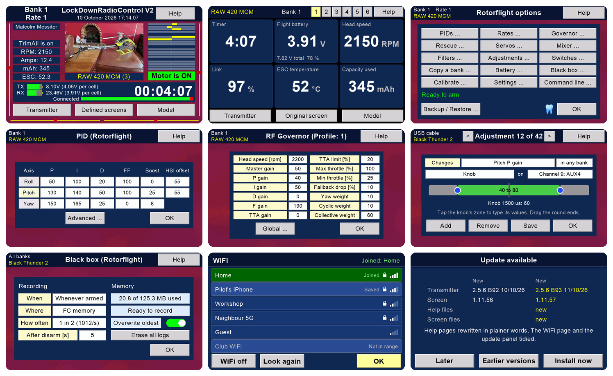
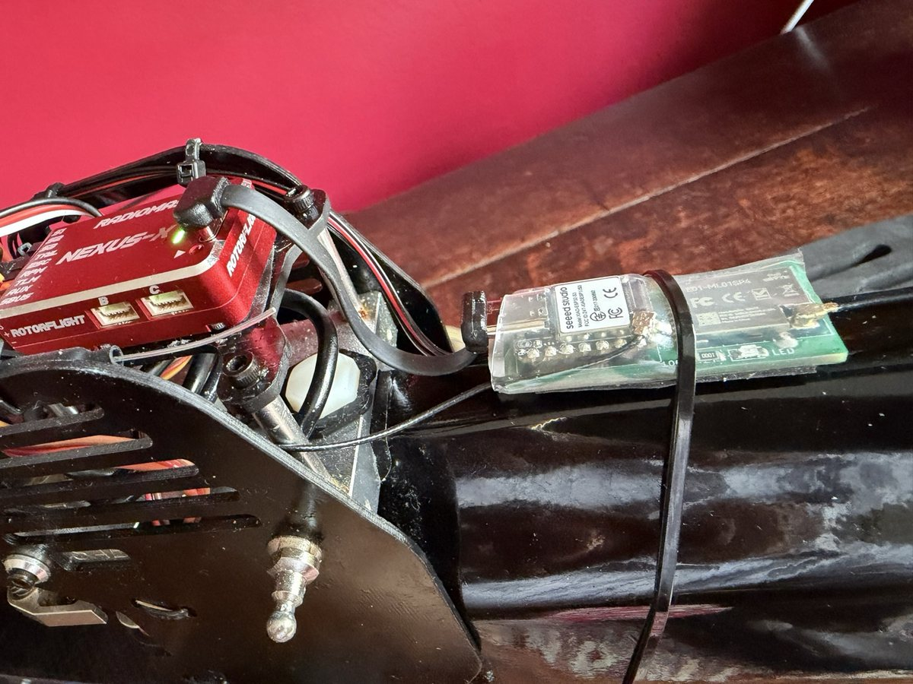
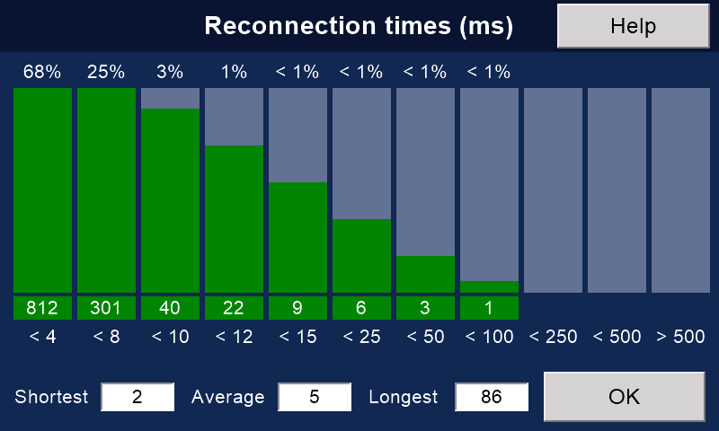
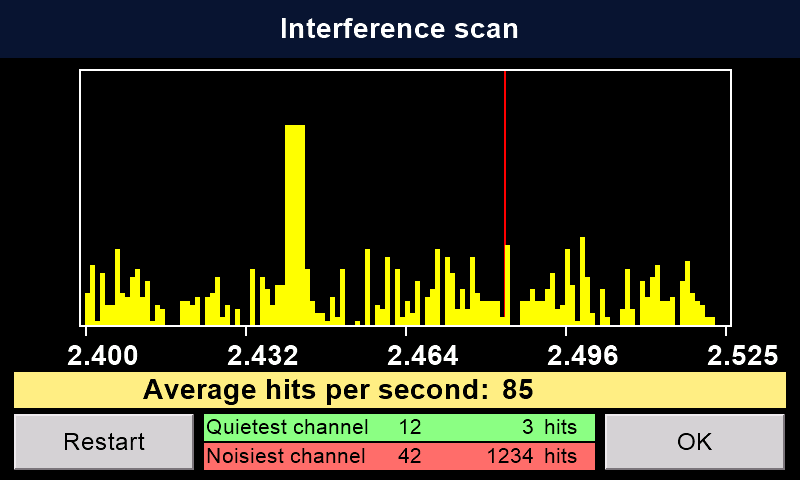

# LockDownRadioControl, Version 2

**A free, open-source radio control system for model aircraft. You build it yourself: a 16-channel transmitter, a receiver and a phone app.**

  

Nine of the transmitter's screens, drawn by its own code. The numbers are sample values.

| I want to… | Go here |
|---|---|
| See what LDRC does | [messiter.com/LDRC.html](https://messiter.com/LDRC.html) |
| Build one | [Build one](https://messiter.com/ldrc/build.html): parts, wiring, flashing, testing |
| Update, or get help | [Help & updates](https://messiter.com/ldrc/help.html) |
| Set up Rotorflight from my phone | [messiter.com/rotorflight](https://messiter.com/rotorflight/) |
| Ask a question | Email Malcolm: [mmessiter@gmail.com](mailto:mmessiter@gmail.com) |

---

## What LDRC is

- **Malcolm Messiter started it in the lockdown of May 2020.** He and his club friends have flown it ever since.
- **Version 1** is in the [LockDownRadioControl](https://github.com/Mmessiter/LockDownRadioControl) repository. It still flies.
- **This repository is Version 2.** It keeps Version 1's radio link and model memories, and adds:
  - a 5-inch WiFi touchscreen on the transmitter,
  - a new receiver,
  - a free phone app for iPhone, iPad and Android.
- It flies planes, gliders and helicopters.
- It is at its best with helicopters that run [Rotorflight](https://www.rotorflight.org/), the free flight-controller software for helicopters.

## The three parts

### 1. The transmitter

A Version 2 transmitter. The pilot chooses the nine boxes on its front screen.
<!-- TODO Malcolm: a better daylight photo of the V2 transmitter, ideally beside a helicopter, when you have one. -->

- **The main board flies the model.** A Teensy 4.1 reads the sticks, does the mixing and runs the radio link.
- **The screen talks to the pilot.** An Elecrow CrowPanel 5.0 (ESP32-S3) draws the pages and looks after WiFi, Bluetooth and updates.
- FrSky M9 Hall-sensor sticks, digital trims, eight three-position switches (four can be knobs), a 3D-printed case.
- **A Version 1 transmitter becomes a Version 2.** Your models, main board, sticks and switches stay. Print the Version 2 case front from [TXV2/STL files/V2](TXV2/STL%20files/V2): it holds the new screen. Fit the screen, and update the firmware.
  <!-- TODO Malcolm: does a Version 1 owner also need the Version 2 case back (TX_BACK12a_V2), or only the front? Until you say, these READMEs and the website say front only. If yes, say "front and back" in all three READMEs and on the website. -->
- Details: [TXV2/README.md](TXV2/README.md) and [TXV2-Screen/README.md](TXV2-Screen/README.md).

### 2. The receiver

A Version 2 receiver in a Goblin 770, beside its Nexus-X flight controller. With the short USB-C cable, the phone app does almost everything Rotorflight's Configurator does. Only flashing Rotorflight itself needs a computer.

- **A Seeed XIAO ESP32-S3 with one, two or three nRF24L01+ radios.** If one radio loses the signal, the next takes over.
- **Talks to a flight controller** over CRSF, SBUS, IBUS or PPM.
- **Sends Rotorflight telemetry** to the transmitter: battery, current, capacity used, head speed, ESC temperature.
- **Updates itself over the air**: from the phone, over WiFi, or through a Version 2 transmitter.
- **Binds to Version 1 and Version 2 transmitters.**
- **The same board has two other jobs:**
  - **dongle**: Rotorflight from your phone on a helicopter flown with any make of radio;
  - **simulator**: plugged into a computer, it lets your transmitter fly RealFlight or neXt (with no radios, it does the same for another make of receiver).
- Details: [RXV2/README.md](RXV2/README.md).

### 3. The phone app

The app's demo mode. It works without any hardware, so you can look round before you build.

- **Free** on the [App Store](https://apps.apple.com/app/id6789857533) (iPhone and iPad) and for Android from [messiter.com/apps](https://messiter.com/apps/). No adverts, no accounts, no tracking.
- **Talks to the receiver over Bluetooth.** No WiFi to join at the field.
- **Sets up Rotorflight in plain English**: wizards for a new helicopter and for tuning, PIDs, rates, governor, rescue, servos, filters, backups.
- **Reads the flight controller's black box** and suggests one filter change at a time.
- Source in [RXV2App](RXV2App).

---

## Why fly LDRC

### Things we know of no other system doing

We checked the makers' own documents in October 2026. "We know of no other" means we did not find it, not that it cannot exist.

1. **The Rotorflight tune and set-up, every bank, backed up on the transmitter and put back exactly.** Each write is read back to check it. After a restore, Rotorflight's own list of changed settings (its `diff all`) was identical to before. Ports, LED, GPS and ESC settings are not included.
2. **Change Rotorflight settings with the model switched off.** The changes are sent when the model next connects.
3. **Rotorflight's command line on the transmitter's screen**, and the whole set-up saved as text. (This needs the receiver's short USB cable to the flight controller.)
4. **Rotorflight set-up from an iPhone or iPad**, in plain English, with step-by-step wizards. Android too.
5. **For Rotorflight: read the black box at the field, with no computer.** See the vibration and get one filter change at a time, with undo.
6. **A chart of how long the link took to reconnect** after every drop.

**Rare: the right model memory loads by itself.** Switch on a model and the transmitter finds its memory. Most radios only stop you flying with the wrong one. Elsewhere we found this only on Multiplex's SMART SX, with its ID receivers (some have a fixed ID, some can be set), and on Mikado's VBar Control, which does it another way: each model's settings live in its VBar unit. Ours learns the ID of any of its own receivers.
<!-- Source: Multiplex shop, RX-5 M-LINK ID receiver: "SMART SX automatically changes the respective model memory based on the ID of the receiver" (shop.multiplex-rc.de, checked 11 Oct 2026). SMART SX 9 FLEXX M-LINK set: the RX-4/9 FLEXX M-LINK ID receiver has an adjustable ID (hobbydirekt.de/Alte-Kategorien/RC/Multiplex-RC/SMART-SX-9-FLEXX-M-LINK-Set-Multiplex-15303::270611.html, checked 11 Oct 2026). -->

<!-- TODO Malcolm: compare.md notes the Battery, Black box and Calibrate pages on the transmitter (B88) had not been tried on hardware on 10 Oct. Confirm before the site calls them proven. -->

  

Rotorflight set-up on the transmitter itself. It needs a Version 2 receiver.

### Also on board

Other systems have most of these too.

- **Wireless buddy box** with no extra modules, and a "nudge" mode: the pupil flies, the instructor can nudge. Once it has the model, the pupil's transmitter loads it by itself. (Spektrum's Pilot Link avoids the need another way: the pupil's radio needs no model at all.)
- **Send a model memory to a friend's transmitter** over the radio link. A Version 1 transmitter can send its models to a Version 2 over the air (tested), and two Version 2s swap them.
- **One-button updates from the internet** for the whole transmitter. It can update the receiver too.
- **Updates that protect your models**: a firmware that would read your models differently is refused, and the old one comes back by itself.
- **The link in detail**: packets a second, lost packets, longest gap, swaps between the receiver's radios, and a scan of the 2.4 GHz band for interference.
- **Your own flight screens**: six designs of up to nine boxes, and twelve colour themes.
- **Help on every page**, on the transmitter itself.
- **Spoken messages**, log files, model pictures sent from your phone, and Pong for rainy days.
- **Safety first: nothing changes in flight.** No transmitter update, file transfer or restart starts while a model is connected. A receiver update runs only with the safety on, and the receiver refuses while armed. WiFi and Bluetooth switch off whenever the model could fly.

  
  

Left: how long the link took to come back after each drop. Right: a scan of the 2.4 GHz band. Sample values.

### Yours to change

LDRC changes when a need appears. Its author, Malcolm Messiter, often adds a feature within a day of a pilot asking for it: the transmitter's command line and the defined front screens were each built the day they were asked for. The new version then reaches every transmitter and receiver over the internet.

It is yours to change too. Every line of code, the circuit boards and the case are open, so you can change anything yourself, or ask for it.

Commercial systems are almost always take it or leave it: you fly what the maker decided, and you cannot easily change it.

### Side by side

Key: **Yes** · **Partly** · **No** · **Not found** = not in the maker's documents we read · **?** = not checked, or we could not confirm · **n/a** = does not apply.
Prices are approximate retail prices in October 2026. LDRC prices are for parts only.

**Link and hardware**

| | LDRC V2 | EdgeTX + ExpressLRS | FrSky Ethos | Spektrum | Mikado VBar Control |
|---|---|---|---|---|---|
| Open-source firmware | **Yes** | **Yes** | No | No | No |
| Boards and case you can build yourself | **Yes** | Partly: ExpressLRS publishes DIY receiver and module boards; the radio is bought | No | No | No |
| Channels | 16 | Up to 32 (ExpressLRS carries 16) | Up to 24 | 20 | ? |
| Fastest packet rate | 500 a second | Up to 1,000 a second | ? | ? | ? |
| Bands | 2.4 GHz | 2.4 GHz and 900 MHz | 2.4 GHz and 900 MHz | 2.4 GHz | 2.4 GHz |
| Published range | None yet | "Over 40 km" (ExpressLRS's own figure, ideal conditions) | "50–100 km" (FrSky's claim) | ? | ? |
| Servo (PWM) outputs on the receiver | Version 1 receiver only | **Yes** | **Yes** | **Yes** | The VBar unit drives the servos |
| GPS and vario | Version 1 receiver only | **Yes** | **Yes** | **Yes** | Partly |
| Certified for sale | No: home-built | **Yes** | **Yes** | **Yes** | **Yes** |
| Price, about | Transmitter: the parts priced so far come to £120–£143, before the switches, trims, radio module, battery, circuit board, case and small parts. Receiver about £35. Parts only, approximate | Radio about £130–£200 (Jumper T15 to TX16S MKII); ExpressLRS receivers from about £11 to £19 (HappyModel EP2, RadioMaster RP1), ready to fly | £460–£600 (X20 family) | £430 (NX10+) | £750 (radio + VBar EVO flybarless unit and receiver) |

**The transmitter**

| | LDRC V2 | EdgeTX + ExpressLRS | FrSky Ethos | Spektrum | Mikado VBar Control |
|---|---|---|---|---|---|
| Loads the right model memory by itself | **Yes**, rare (elsewhere found only on Multiplex SMART SX and VBar Control) | No: Model Match only blocks control | Not found | No: ModelMatch only blocks the wrong memory | **Yes**, another way: each model's settings live in its VBar unit |
| Wireless buddy box, no extra hardware | **Yes**, with nudge; the pupil's radio loads the same model | Partly: radios with Bluetooth | **Yes** | **Yes** | **Yes** |
| Send a model memory to another transmitter, no wires | **Yes**, over the radio link | No | ? | **Yes** (iX20, Bluetooth) | Partly |
| Updates itself from the internet | **Yes**, the whole radio, with automatic roll-back | No: a computer and a browser | No: USB or SD card | **Yes**, WiFi | **Yes**, WiFi |
| Updates the receiver through the transmitter | **Yes** | Partly: the receiver's own WiFi page | **Yes** | ? | **Yes** |
| Help on every page, on the radio | **Yes** | Not found: online manual | ? | ? | **Yes**: a (?) on every setting |
| Scripts and add-on apps | No, by choice | **Yes**: Lua | **Yes**: Lua | **Yes**: apps on iX20 | **Yes**: app store |
| Mixer depth | 16 channels, 4 flight modes, 32 mixes | Much deeper | Deep | Deep | Made for helicopters |

**Helicopters with Rotorflight**

| | LDRC V2 | EdgeTX + ExpressLRS | FrSky Ethos | Spektrum | Mikado VBar Control |
|---|---|---|---|---|---|
| Rotorflight telemetry on the transmitter | **Yes** | **Yes** | **Yes** | Partly | **Yes**, for VBar units |
| Rotorflight set-up from the transmitter | **Yes**: PIDs, rates, governor, rescue, servos, mixer, filters, adjustments, switches, copy a bank, battery, black box | **Yes**: PIDs, rates, governor, rescue, servos, mixer, filters, battery, ESCs of 8 makes (Rotorflight's Lua scripts) | **Yes, and wider**: over 80 pages, ESC tools | Not found | **Yes**, for VBar units |
| Back up Rotorflight on the transmitter, restore exactly | **Yes**: every bank; not ports, LED, GPS or ESC | Not in the Rotorflight scripts | No | n/a | A separate app, for VBar |
| Edit with the model switched off, send later | **Yes** | Not found | Not found | n/a | Not found |
| Phone app for Rotorflight on iPhone and Android | **Yes**, free | Partly: Rotorflight's configurator on Android (app, or Chrome at cfg.rotorflight.org), by USB cable; no iPhone app | as EdgeTX | n/a (an app for its own flybarless units) | n/a (set-up is on the radio) |
| Black box vibration check without a computer | **Yes** | No | Partly: no spectrum | No | **Yes**, for VBar |
| ESC programming | Partly: from the phone, Scorpion only, beta | **Yes**: 8 makes (Rotorflight's Lua scripts) | **Yes**: 10 ESC families | Spektrum Smart ESCs | **Yes** |

Sources for the table

- ExpressLRS: [home page](https://www.expresslrs.org/), [signal health and range](https://www.expresslrs.org/info/signal-health/), [Model Match](https://www.expresslrs.org/software/model-config-match/), [WiFi updating](https://www.expresslrs.org/software/updating/wifi-updating/), [DIY receivers](https://www.expresslrs.org/hardware/special-targets/diy-rx/)
- EdgeTX: [limits in the source](https://github.com/EdgeTX/edgetx/blob/main/radio/src/dataconstants.h), [Bluetooth](https://manual.edgetx.org/v2.9/edgetx-how-to/use-bluetooth-with-edgetx), [updating with EdgeTX Buddy](https://manual.edgetx.org/installing-and-updating-edgetx/update-from-opentx-to-edgetx)
- Rotorflight: [Lua scripts](https://github.com/rotorflight/rotorflight-lua-scripts) ([their pages in release 2.3.0](https://github.com/rotorflight/rotorflight-lua-scripts/tree/release/2.3.0/src/SCRIPTS/RF2/PAGES)), [Ethos suite](https://github.com/rotorflight/rotorflight-lua-ethos-suite), [configurator releases](https://github.com/rotorflight/rotorflight-configurator/releases)
- FrSky: [Tandem X20 review](https://oscarliang.com/frsky-tandem-x20), [ACCESS receivers](https://oscarliang.com/frsky-access-protocol/)
- Spektrum: [NX10+](https://modelhelicopters.co.uk/products/spektrum-nx10-20-channel-dsmx-transmitter-only-spmr10120eu), [iX20](https://modelhelicopters.co.uk/products/spektrum-ix20-20-channel-smart-transmitter-spmr20100eu-spmr20100eu), [wireless buddy box](https://flitetest.com/articles/wireless-buddy-box)
- Mikado: [VBar Control Touch EVO](https://modelhelicopters.co.uk/products/mikado-vcontrol-touch-evo-combo-red-05585), [release notes, Nov 2025](https://www.vstabi.info/en/update_release_nov_2025), [VBar Control Touch manual](https://www.mikado-heli.de/downloads/anleitungen/vcontrol/VBar_Control_Touch_201_EN.pdf) (help on the radio; the model's screen on connection), [Model Aviation review, August 2019](https://www.modelaviation.com/mikado-vbar-control) (each model's settings live in its VBar unit)
- Multiplex: [RX-5 M-LINK ID1 receiver](https://shop.multiplex-rc.de/en/receiver-rx-5-m-link-id-1-2-4-ghz-p5007/) (SMART SX loads the model memory from the receiver's ID)
- LDRC's own facts come from the code and help texts in this repository.

### The price, honestly

- The transmitter parts priced so far come to £120–£143, before the switches, trims, radio module, battery, circuit board, case and small parts. A budget EdgeTX radio is about £130.
- It costs far less than the X20, NX10+ or VBar Control in the table. Ethos and Spektrum also make cheaper radios (a FrSky X14 is about £170).
- The value is not "the cheapest radio". Budget EdgeTX radios can already tune Rotorflight with Rotorflight's own scripts. We did not find the Rotorflight backup, editing with the model off, or the command line on any other radio.
<!-- Sources: FrSky Twin X14 £168–£178.90 at FlyingTech UK; VBar Control Touch EVO combo £749.99 "Includes VBar EVO VLink Flybarless/Receiver unit" (modelhelicopters.co.uk), both checked 11 Oct 2026. TODO Malcolm: once the full parts total is known, put back a fair comparison with a budget EdgeTX radio. -->
- Add your own time: a transmitter takes a few evenings, plus printing the case; a receiver about an evening.

<!-- TODO Malcolm: the transmitter says "over £120 in parts (approximate)", as on the website: the parts the Build one page prices (Teensy, INA219, Pololu 2808, CrowPanel, gimbals £40-£60 a pair) already come to about £120-£143, and the rest are unpriced. "about £35 of parts" for the receiver is the receiver's own help text (RXV2/data/dongle.html), the same as the website. Please re-cost the V2 parts. -->

---

## The numbers

- **16 channels**, about 2,000 steps each (whole microseconds, 500 to 2,500), sent in 12-bit slots; 11-bit out of the receiver on CRSF or SBUS.
- **500 packets a second.** Fewer while buddy-boxing, because the instructor's transmitter also talks to the pupil's.
- **Frequency hopping across 83 channels** of the 2.4 GHz band, about 100 hops a second. The receiver chooses each next channel.
- **250 kbit/s** over the air. One quick retry for a lost packet, then fresh stick data, never a stale backlog.
- **1, 2 or 3 radios** in a receiver, with automatic switching.
- **Outputs:** CRSF (250 frames a second by default), SBUS, IBUS, PPM.
- **Measured on the first Version 2 flight** (Goblin RAW 420, 5 October 2026): 491 packets a second on average, 0.21 % of packets lost, longest gap 15 ms.
- **90 model memories**, backups as many as the card holds, 4 banks (flight modes) per model, 32 mixes, 3 rates, 8 macros, help on every page (60 help texts).

<!-- TODO Malcolm: 90 memories: the code (MAXMODELNUMBER 91: the Models page, automatic model selection and the buddy match run 1-90) and MODELS.TXT say 90. Only the Check IDs page (Model_IDs.h) scans 1-89: please check memory 90 shows there. -->

<!-- TODO Malcolm: no range figure is quoted. The memory notes record a ground range test of about half a mile on 5 Oct 2026 with ~500 packets a second at full distance. Say if you want that published. -->

---

## How to get one

There is nothing to buy from us. You build your own, and Malcolm will help.

1. **Read [Build one](https://messiter.com/ldrc/build.html)** on the website: parts, costs, the order of work, and testing before the first flight.
2. **Transmitter:** order the circuit board, print the case, solder, flash once by USB. See [TXV2/README.md](TXV2/README.md).
3. **Screen:** flash it once by USB, give it your WiFi, and it fills its own card. See [TXV2-Screen/README.md](TXV2-Screen/README.md).
4. **Receiver:** build it, flash it in your browser at [messiter.com/rotorflight/flash.html](https://messiter.com/rotorflight/flash.html), wire it to the flight controller. See [RXV2/README.md](RXV2/README.md).
5. **App:** install it from the [App Store](https://apps.apple.com/app/id6789857533) or [messiter.com/apps](https://messiter.com/apps/).
6. **Test on the ground**, blades off, before the first flight.

After the first flash, everything updates over the air.
Current versions and release notes: [Help & updates](https://messiter.com/ldrc/help.html).
(For the technically minded: the transmitter reads its releases from [txv1b/release/latest.txt](https://messiter.com/txv1b/release/latest.txt), the receiver from [rxv2/release/manifest.json](https://messiter.com/rxv2/release/manifest.json).)

**Already fly a commercial radio?** You can still use the phone app. Build a **dongle** (a XIAO ESP32-S3 and four wires) and set up Rotorflight from your phone: [messiter.com/rotorflight/dongle.html](https://messiter.com/rotorflight/dongle.html).

### Safety and the law

- **Check your local rules.** A home-built transmitter has no CE, UKCA or FCC marking. In the UK and EU, 2.4 GHz equipment is expected to meet ETSI EN 300 328, which asks for "adaptivity" such as listen-before-talk. LDRC has no listen-before-talk mode.
- **Full power, always.** The transmitter's and the receiver's radio modules always run at full power, about 100 mW (20 dBm). The UK and EU limit is 100 mW including the aerial's gain. A normal aerial adds 2 to 3 dBi, so **the total is probably over that limit**.
  <!-- TODO Malcolm: please confirm the radio modules' output. Ebyte sells the ML01DP5 (transmitter) and the ML01SP4 (receiver) as 20 dBm (100 mW); both firmwares always set RF24_PA_MAX (TXV1B transceiver.h line 16, RXV2 Radio.h line 553). -->
- **Test every new build on the ground first**, blades off: do every check in [Build one](https://messiter.com/ldrc/build.html#testing), the failsafe and range tests included.
- You fly at your own risk. The licences below come with no warranty.

---

## What is in this repository

| Folder | What it is |
|---|---|
| [TXV2](TXV2) | The transmitter: the Teensy 4.1 firmware, help texts, sounds, the case (STL and STEP), the circuit boards (Gerbers), the change log |
| [TXV2-Screen](TXV2-Screen) | The transmitter's screen: the ESP32-S3 firmware, everything on its card (pages, fonts, pictures, sounds), tools and tests |
| [RXV2](RXV2) | The receiver (also the dongle and the simulator interface): firmware, web pages, the case, tools and tests |
| [RXV2App](RXV2App) | The phone app for iPhone, iPad and Android |
| [TXV3](TXV3) | Notes and boards for a future transmitter with boards of its own. Parked: Version 2 turned out so well that it may wait a long time |
| [docs/images](docs/images) | The pictures in these READMEs |

TXV2 and TXV2-Screen are copies of Malcolm's working repositories, refreshed with every release. A private settings file and bulky leftovers (old Version 1 screen files, logs, build output) are not copied.

---

## Licence and credits

Free for other flyers, and derivatives must stay free:

| What | Licence |
|---|---|
| Code: the screen, the receiver, the apps, the web pages, the tools | **GPL-3.0-or-later** ([LICENSE](LICENSE)), with an [app-store exception](LICENSE-EXCEPTION.txt) |
| The transmitter's Teensy firmware | **GPL-2.0-or-later** ([TXV2/LICENSE](TXV2/LICENSE)), like Version 1 |
| Circuit boards | **CERN-OHL-S-2.0** |
| Manuals, help texts, the screen's pages and sounds, pictures, case files | **CC BY-SA 4.0** |

Details in [LICENSING.md](LICENSING.md).

**Made by Malcolm Messiter**, with **Claude** (Anthropic's AI) as pair programmer. Copyright (C) 2020–2026 Malcolm Messiter.

Featured on [Hackaday](https://hackaday.com/2025/04/04/lockdown-remote-control-project-is-free-and-open/) in April 2025.
App pages: [Support](https://messiter.com/rxv2/support.html) · [Source](https://messiter.com/rxv2/source.html) · [Privacy](https://messiter.com/rxv2/privacy.html).
