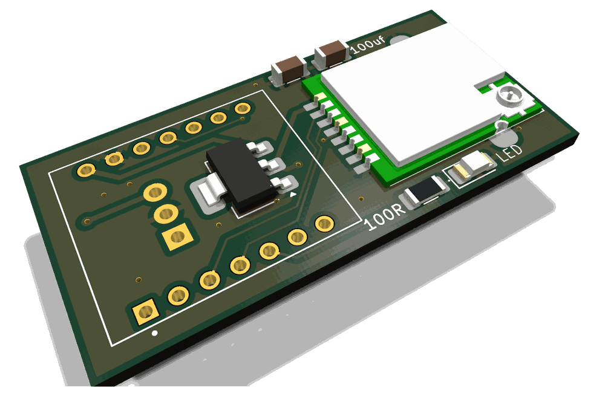
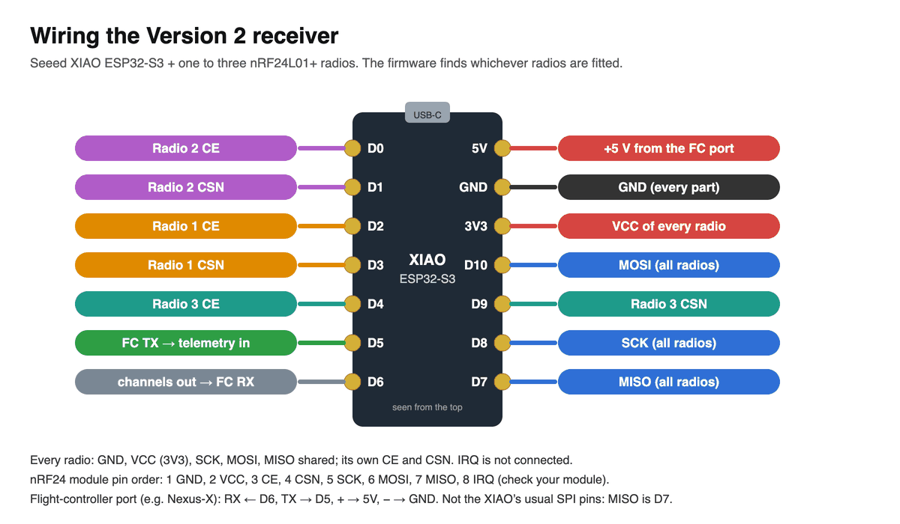

# The Version 2 receiver


<sub>A Version 2 receiver in a Goblin 770, beside its Nexus-X flight controller, with the short USB-C cable fitted.</sub>

**A small receiver that talks to a flight controller, and sets up Rotorflight from your phone.**

- **What it is:** a Seeed **XIAO ESP32-S3** with one, two or three **nRF24L01+ radios** (Ebyte E01-ML01SP4, or any nRF24 module). If one radio loses the signal, the next takes over.
- **It binds to Version 1 and Version 2 transmitters**, exactly as the Version 1 receiver does.
- **User guide and one-click flashing:** [messiter.com/rotorflight](https://messiter.com/rotorflight/). **Build guide:** [Build one](https://messiter.com/ldrc/build.html).
- **This README** is for builders: parts, wiring, flashing, connecting and testing.

---

## What it does

- **Drives a flight controller** on one wire: **CRSF** (the default, 250 frames a second), **SBUS**, **IBUS** or **PPM**.
- **Sends Rotorflight telemetry** to the transmitter: flight-battery volts, current, capacity used, head speed, ESC temperature.
- **Sets up Rotorflight** from the phone app (Bluetooth) or any browser (its own WiFi): wizards for a new helicopter and for tuning, PIDs, rates, governor, rescue, servos, filters, six banks, backups, flight recordings, a black box check.
- **Lets a Version 2 transmitter edit Rotorflight** too, over Bluetooth.
- **With a short USB-C cable to the flight controller** it can do almost everything Rotorflight's configurator does. Only flashing Rotorflight itself needs a computer. That includes the command line, in-flight adjustments, ports, and reading the black box.
  <!-- TODO Malcolm: confirm the app covers every Configurator 2.3.0 tab before saying "everything". -->
- **Updates itself over the air:** from the phone, over WiFi, or through a Version 2 transmitter. A failed update leaves the old firmware in place.
- **Looks after itself:**
  - It starts **disarmed and safe** before any transmitter is heard.
  - WiFi and Bluetooth **switch off about a second after arming**, and come back when you disarm, or 10 seconds after the transmitter goes quiet.
  - **Nothing can be changed while the model is armed.** Every setting it writes is read back to check it.
- **The same board has other jobs:**
  - **Dongle:** with no radios fitted, on a spare flight-controller port, it gives the phone app to a helicopter flown with any make of radio. See [messiter.com/rotorflight/dongle.html](https://messiter.com/rotorflight/dongle.html).
  - **Simulator mode:** plugged into a computer (flight controller unplugged), it becomes a USB joystick and keyboard, so your transmitter flies RealFlight or neXt.
  - **Simulator interface** (no radios fitted): turns another make of receiver, wired to D5, into the same USB joystick.

**What it does not do.** It has **no servo (PWM) outputs**, and **no GPS or vario**. For those, use the Version 1 receiver ([LockDownRadioControl](https://github.com/Mmessiter/LockDownRadioControl)), or a CRSF/SBUS-to-PWM converter.

---

## What is in this folder

| | |
|---|---|
| `src/` | The firmware: the radio link, the flight-controller output, MSP to Rotorflight, the web and Bluetooth bridges, the simulator joystick |
| `data/` | The web pages. The receiver serves them, and the apps carry a copy. Written to the chip's LittleFS |
| `lib/` | Libraries kept with the project |
| `case/` | The receiver's printed case (STEP). Print it in PETG or PLA |
| `kicad/dongle/` | **Do not order this board.** It is the dongle carrier with the wiring error. See [kicad/dongle/README.md](kicad/dongle/README.md) |
| `dev/` | Tools: `flash_usb.sh` and `flash_receiver.sh` for a new board, `release.sh` for a release, the host tests, `stage_fs.py` (packs the pages) |
| `Connections.txt` | The wiring of the radios and the flight controller |
| `*.md` | Notes worked out along the way: the black box format, MSP details, the Scorpion ESC protocol |

---

## Build one

> [!WARNING]
> **Check your local rules.** A home-built radio has no CE, UKCA or FCC marking. In the UK and EU, 2.4 GHz equipment is expected to meet ETSI EN 300 328, which asks for listen-before-talk; LDRC has none. The transmitter's and the receiver's radio modules always run at full power, about 100 mW (20 dBm); with a normal aerial's gain the total is probably over the UK and EU limit of 100 mW. You fly at your own risk.

There are two ways: on the circuit board, or hand-wired.

### On the circuit board



<sub>The receiver board, about 46 × 22 mm, drawn from its design files. The XIAO sits in the outlined area (not drawn). A second radio sits on the back.</sub>

**The board files are being prepared for publishing.** Until then, hand-wire a receiver (below), or email Malcolm at [mmessiter@gmail.com](mailto:mmessiter@gmail.com).

<!-- TODO Malcolm: which board is the production one, RXV2_NEWA or RXV2_NEWB? Publish its KiCad files and Gerbers to RXV2/kicad/receiver/ (and the RXV2_VDIV divider board). Will you offer bare boards from your batch of 100? -->

**Parts for one board** (from the board's design):

| Part | What to buy | Qty | Notes |
|---|---|---|---|
| Brain | Seeed Studio **XIAO ESP32-S3** | 1 | Fit a **dipole** aerial to its WiFi socket. The small supplied aerial works far less well |
| Radios | Ebyte **E01-ML01SP4** (nRF24L01+ with amplifier) | 2 | One on each side. Each needs a 2.4 GHz IPEX **dipole**. Mount the two aerials about 90° apart |
| 5 V regulator | Pololu **S7V7F5** step-up/step-down (or a 7805) | 1 | **Use the S7V7F5** if the flight controller's 5 V powers the receiver. A 7805 cannot make 5 V from 5 V. The S7V7F5 takes 2.7–11.8 V |
| 3.3 V regulator | **AMS1117-3.3** (SOT-223) | 1 | For the radios |
| Lead socket | JST-GH 4-pin, **SM04B-GHS-TB** | 1 | The lead to the flight controller |
| Capacitors | 1206: 100 µF ×2, 22 µF ×1, 10 µF ×1 | 4 | |
| Status light | LED 1206 and a 100 Ω 1206 resistor | 1 each | |
| Case | [`case/`](case): `RXV2_A_CASE.step` and `RXV2_A_LID.step` | 1 set | Printed in PETG or PLA |
| USB-C cable (optional) | A short **data** cable, receiver to flight controller. Malcolm uses a Chenyang CY-UC-088-0.07M (70 mm, right-angled both ends) | 1 | Unlocks the full Rotorflight set-up |

**Cost:** about £35 of parts (approximate, October 2026).
<!-- TODO Malcolm: the case (RXV2/case, commit 9bc8f12c, June 2026) is still local only: push 9bc8f12c with this README: receiver.html and build.html already link RXV2/case. Which board does it fit, NEWA or NEWB? -->
<!-- TODO Malcolm: re-cost the V2 receiver. compare.md estimates £15-£25 for the XIAO and radios alone; £35 is the figure in the receiver's own help text and on the website. -->

**The lead socket (J2):**

| Pin | Job | Goes to the flight controller's |
|---|---|---|
| 1 | Channels out (D6) | RX |
| 2 | Telemetry in (D5) | TX |
| 3 | Power in | + |
| 4 | Ground | − |

With this order, a straight one-to-one lead to a Nexus port (RX, TX, +, −) crosses TX and RX correctly. **Check the lead with a meter before the first power-up.**

**Soldering the XIAO: the one thing that goes wrong.**
- Dry joints on the XIAO's half-holes (castellations) were the fault on every early board. The solder sits on the pad and looks fine, but never flows into the half-hole.
- **Finish every XIAO pin with the iron:** a little more solder, a little longer, one pin at a time, until it flows in. Then look with a magnifier.
- With hot air, use about 300 °C and flux. 250 °C gave cold joints.
- **Symptoms of a dry joint:**
  - Restarts over and over on battery, but fine on USB: a ground joint.
  - Finds 0 or 1 radio instead of 2: a radio-bus joint.
  - Controls work, but no Rotorflight or telemetry: the D5 joint.
- Keep parts with a polarity on the front of the board, to avoid mirror mistakes.

<!-- TODO Malcolm: (1) U4: in the NEWA/NEWB schematic the supply goes to the regulator's pin 3 and 5 V comes out of pin 1, the reverse of a 7805. On the first board the module went on upside down. Which way does it go on the production board? (2) D1: the schematic has the LED's anode on ground, but the firmware drives D4 high to light it. Fit the cathode to ground? (3) Weight and current draw of a finished receiver (none measured). -->

### Hand-wired (no circuit board)



<sub>Wiring a receiver by hand. Seen from the top, USB socket upwards.</sub>

| XIAO pad | ESP32-S3 GPIO | Goes to |
|---|---|---|
| D2 | 3 | Radio 1 CE |
| D3 | 4 | Radio 1 CSN |
| D0 | 1 | Radio 2 CE |
| D1 | 2 | Radio 2 CSN |
| D4 | 5 | Radio 3 CE (or the status LED, with no third radio) |
| D9 | 8 | Radio 3 CSN (or the battery divider, with no third radio) |
| D7 | 44 | MISO, every radio |
| D8 | 7 | SCK, every radio |
| D10 | 9 | MOSI, every radio |
| 3V3 | – | VCC, every radio |
| GND | – | GND, every radio, and the flight controller's − |
| **D5** | **6** | **Telemetry in ← the flight controller's TX** |
| **D6** | **43** | **Channels out → the flight controller's RX** |
| 5V | – | + from the flight controller's port |

> [!WARNING]
> Hand-wired, the XIAO takes its 5 V straight from the flight controller's port. Use only a port that gives a steady 5 V, such as a Nexus receiver port. Never a servo or BEC pin: those can carry 6–8.4 V and will destroy the XIAO.

- **The firmware works by the D-labels.** Wire by the D-labels and it is right.
- The nRF24 module's pins, in order: GND, VCC, CE, CSN, SCK, MOSI, MISO, IRQ. **Leave IRQ unconnected.**
- Fit one, two or three radios. The receiver finds them at start-up, and its home page says which slots came up.
- The radios use D7 for MISO, not the XIAO's usual SPI pin.
- Put a 100 µF capacitor across each radio's VCC and GND, close to the radio, as the board does.

<!-- TODO Malcolm: the board feeds the radios from its own AMS1117. Is the XIAO's 3V3 pad enough for two or three ML01SP4s in a hand-wired receiver, or should builders fit an AMS1117 too? Also confirm the 100 µF per radio advice for hand-wired builds. -->

### Battery sensing (optional)

- The receiver can read the flight battery itself. You need this only if the flight controller does not send battery volts.
- Make a divider: 220 kΩ (two 110 kΩ in series) from the battery to the pin, 10 kΩ from the pin to ground (a ratio of 23, up to 12S). Add a 1 kΩ series resistor and 100 nF to ground.
- The sense wire goes to **D9**, the only pad allowed. Set the ratio and the cell count on the receiver's settings page, and check it against a meter.
- It also lets the receiver warn at 3.50 V a cell, and sleep at 3.30 V if the model has clearly been forgotten.

---

## Flash it

Choose one way. After this, the receiver updates itself.

> [!WARNING]
> **Never two power supplies.** Flash the receiver before it is wired to the flight controller, or with the flight controller unplugged. Never plug a computer into the receiver's USB socket while the model's battery is connected.

**1. In your browser (easiest).** Chrome, Edge or Opera on a desktop or laptop.
1. Plug the XIAO in with a USB-C **data** cable.
2. **Hold B, tap R, let go of B.** The yellow light goes out. (Do this every time.)
3. Open [messiter.com/rotorflight/flash.html](https://messiter.com/rotorflight/flash.html) and click the button. It erases the chip first, then writes for about a minute.
4. **Unplug and plug back in.** The board does not restart by itself.

**2. With esptool** (`pip install esptool`). Download these five files into one folder: [bootloader.bin](https://messiter.com/rxv2/release/latest/bootloader.bin), [partitions.bin](https://messiter.com/rxv2/release/latest/partitions.bin), [boot_app0.bin](https://messiter.com/rxv2/release/latest/boot_app0.bin), [firmware.bin](https://messiter.com/rxv2/release/latest/firmware.bin), [littlefs.bin](https://messiter.com/rxv2/release/latest/littlefs.bin). Then write them, with your own port:

```
esptool --chip esp32s3 --port <your port> --baud 921600 write_flash -z --flash_mode dio --flash_freq 80m --flash_size 8MB 0x0 bootloader.bin 0x8000 partitions.bin 0xe000 boot_app0.bin 0x10000 firmware.bin 0x670000 littlefs.bin
```

Every file must report "Hash of data verified". Without `littlefs.bin` the pages are blank.

**3. From source.** You need [PlatformIO](https://platformio.org/) and Node.js (the page tests use it).

```
cd RXV2
dev/flash_usb.sh            # on a Mac: builds, finds the port, writes everything
dev/flash_usb.sh --dance    # after hold B, tap R, let go of B
```

By hand, on any computer:

```
pio run -e xiao_s3_usb -t upload   --upload-port <your port>
pio run -e xiao_s3_usb -t uploadfs --upload-port <your port>
```

(`platformio.ini` names Malcolm's own port, so give yours.)

**No port appears?**
- It is usually a **charge-only cable**. The orange light comes on from power alone.
- A board already running this firmware offers no USB port. Hold B, tap R, let go of B first.

---

## First start

1. Fit the aerials, then power the board.
2. **It calls itself "Untitled".** Rename it at once: two boards with the same name cannot be told apart.
   - **With the app:** open it, tap *Connect*, tap *Untitled*.
   - **With a computer:** join the WiFi network called *Untitled*, then open `http://192.168.4.1`. (A phone's sign-in window drops this network, so use a computer.)
3. Give it your WiFi, if you want it to update over WiFi.
4. **The status light:** off = bound but no transmitter; on = receiving; flashing twice a second = binding.

## Connect it to the flight controller

- **Do not power the servos** until Rotorflight's servo settings and the BEC voltage are right. Wrong settings can burn a servo in seconds.
- **Use the flight controller's receiver port** (Nexus "Port A"; "RX" or "ELRS" on many boards). TX to RX, RX to TX, plus power and ground.
- **In Rotorflight:** set that port to *Serial RX* with **CRSF**, and **switch the TELEMETRY feature on**. New boards come with telemetry off, and then the flight controller ignores the receiver's questions.
- **Easier:** fit the USB-C cable from the receiver to the flight controller, open the app's *Ports* page, and one Save does all of that.
- **No Rotorflight button in the app?** Swap TX and RX first. Crossed wires are the usual cause.
- **For head speed and ESC temperature** on the transmitter, switch on the RPM and temperature sensors in Rotorflight's CRSF telemetry, and set the gear ratio.

## Bind it

- **Blades or propeller off, safety on**, before the model is switched on.
- **Receiver:** a new receiver is in bind mode already. On a bound one, press **Bind** on its home page. (**Cancel bind** puts the old pairing back.)
- **Transmitter:** hold its power button for 2–5 seconds while switching on, or use *Transmitter setup → System → General → Bind*.
- **First connection:** choose an empty model memory first. When the transmitter asks to save the receiver's ID, press OK (Cancel saves nothing, and the model does not connect). Check it on *Model setup → Model IDs*. From then on the transmitter loads it by itself.
- Note: the link address is the transmitter's ID, so one transmitter can bind any number of receivers. **Every one of them obeys it: switch on one model at a time.**

## Test before you fly

Blades off for every test. Unplug the motor too, unless the test needs it. The full list is on [Build one](https://messiter.com/ldrc/build.html).

1. **Radios:** the home page shows how many radios it found, and the radio self-test says PASS.
2. **Link:** switch the transmitter on and off. Watch each radio go "receiving", "standby", "listening".
3. **Controls:** *View channels* shows 16 live bars and a 3-D helicopter that follows your sticks.
4. **Telemetry:** wired to the flight controller, the transmitter shows volts, head speed and ESC temperature.
5. **Failsafe:** set it first (SBUS/IBUS/PPM: on the transmitter; CRSF with Rotorflight: Rotorflight's own Failsafe tab, in the Configurator). Blades off, model held down, run the motor slowly, then switch the transmitter off: the motor stops and stays stopped.
6. **Range:** walk well past your flying distance with a helper at the model, safety on ([Build one](https://messiter.com/ldrc/build.html#testing) has the steps).
7. **After the first hover:** *Flight analysis* shows the link. A longest gap under about 30 ms is excellent.
8. **Back up** the Rotorflight settings before the first real flight.

---

## The phone app

- **iPhone and iPad:** [App Store](https://apps.apple.com/app/id6789857533) ("LockDownRadioControl RXV2"). Testers: [TestFlight](https://testflight.apple.com/join/6yzhGxae).
- **Android:** [messiter.com/apps](https://messiter.com/apps/).
- Free. No adverts, accounts or tracking. One phone at a time can be connected to a receiver.
- **Demo mode** works with no hardware.
- Source: [../RXV2App](../RXV2App).

## Updates

Three ways, all keeping your settings, binding, flights and backups:

1. **From the app**, over Bluetooth. The phone downloads the update and passes it on. It works at the field.
2. **Over the receiver's WiFi**, from its *Check for update* page.
3. **Through a Version 2 transmitter:** *Model setup → Receiver updates*, with the model on and connected, with the safety on (with no safety switch: the motor off). The receiver joins the WiFi it knows and installs. No app needed.

You can roll back to an older version from the same page. Updates never run while the model is armed.
Current version and notes: [Help & updates](https://messiter.com/ldrc/help.html).

## Tests

The host tests run on a Mac or Linux without a board: `dev/page_test.js`, `dev/replay_test.js`, `dev/bbcheck_test.sh`, `dev/prelink_hold_test.sh` and their neighbours in `dev/`. `dev/release.sh` runs all of them before anything is published.

## Licence

Code, including the web pages in `data/`: GPL-3.0-or-later. Boards: CERN-OHL-S-2.0. Help texts, pictures and the case: CC BY-SA 4.0. See [../LICENSING.md](../LICENSING.md).
Copyright (C) 2026 Malcolm Messiter. Made with Claude (Anthropic's AI) as pair programmer.
