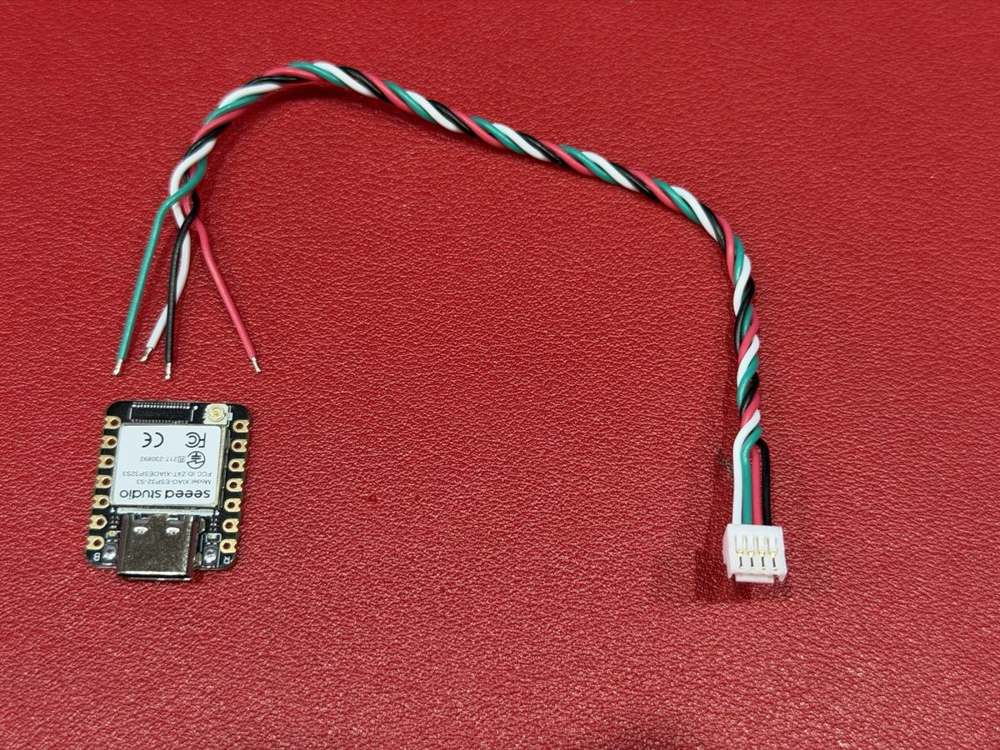

# Do not order this board

> [!WARNING]
> **The board in this folder is wrong. Do not order it, and do not build it.**
> It can destroy a XIAO, and could harm your flight controller.

## What is wrong

- This is the first-batch carrier board for the dongle: `RXV2_DONGLE_gerbers.zip`, `RXV2_DONGLE.kicad_pcb`, `render.png`, `make_dongle.py`.
- **Its connector is wired the wrong way round on all four pins**, and TX and RX are swapped as well.
- So the flight controller's **+5 V lands on the XIAO's D6 pin**. That killed two XIAOs before the fault was found.
- The batch was binned, and the board was dropped. The files stay here only as a record.

<!-- TODO Malcolm: consider deleting RXV2_DONGLE_gerbers.zip (and the .kicad_pcb) from the repository so nobody can order it by mistake; git history keeps it. -->

## Build the dongle with four wires instead

All a dongle needs: a XIAO ESP32-S3 and a four-wire lead (here the one from the Nexus box).

**You need:**
- a Seeed **XIAO ESP32-S3**, with its aerial;
- a four-wire lead that fits a spare port on your flight controller (the lead in the Nexus box is the easiest);
- heat-shrink sleeving.

**Wire it:**

| Flight controller's port | XIAO pad | Colour on Malcolm's Nexus lead |
|---|---|---|
| RX | **D6** | white |
| TX | **D5** | green |
| + 5 V | **5V** | red |
| − | **GND** | black |

- **Check every wire with a meter before you plug it in.** Other leads use other colours, and reversed power can destroy the flight controller.
- On the XIAO (USB end at the top), 5V and GND are the top two pads on the right. D5 and D6 are the bottom two on the left. Go by the printed labels.
- Shrink-wrap it, leaving the USB-C socket clear.

**Plug it in:**
- On a Nexus, use **port B or C**, never A. Port A belongs to the receiver.
- Fit a USB-C data cable from the flight controller to the dongle: nothing to set. To use the lead alone, set that port to **MSP, 115200** in Rotorflight.
- **Power it from the flight controller only.** While it is wired to the flight controller, never plug a computer, charger or power bank into its USB socket: two supplies would meet. (Flash it with the flight controller unplugged.)

**Flash it** in your browser: [messiter.com/rotorflight/flash.html](https://messiter.com/rotorflight/flash.html).

**The full guide**, with photos, other flight controllers and first switch-on: [messiter.com/rotorflight/dongle.html](https://messiter.com/rotorflight/dongle.html).

---

Licence: boards CERN-OHL-S-2.0. See [../../../LICENSING.md](../../../LICENSING.md).
