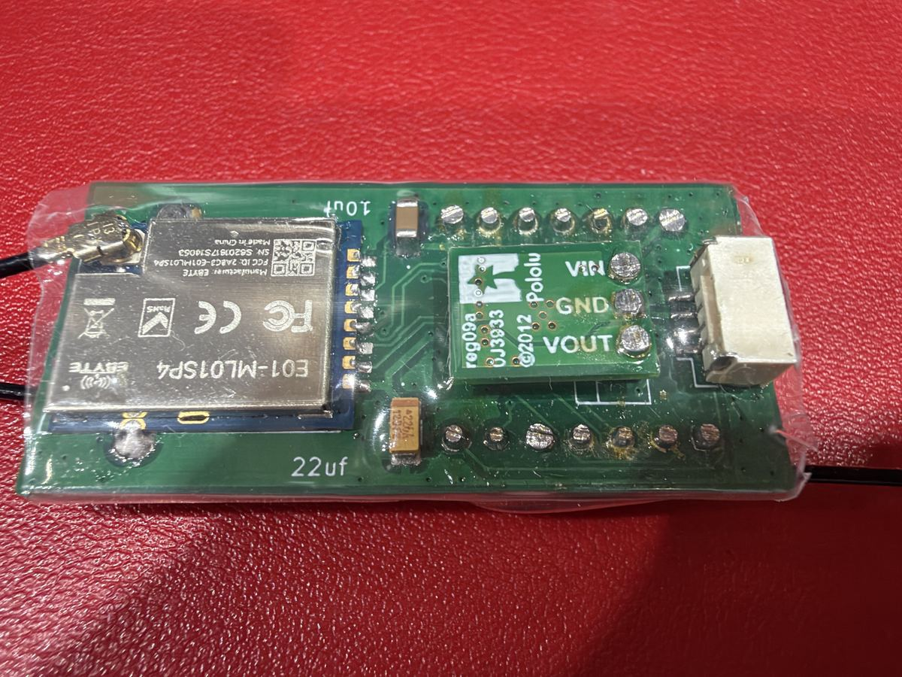
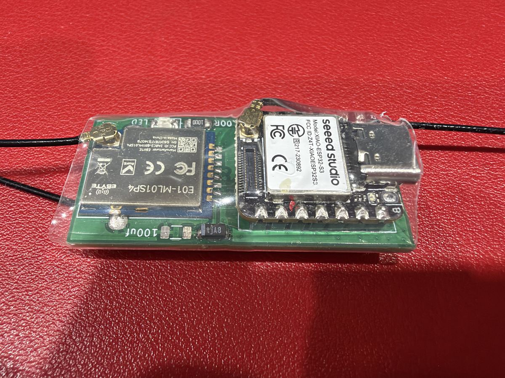

# The receiver's circuit board (RXV2_NEWB)

The production board of the Version 2 receiver: a Seeed **XIAO ESP32-S3** and two Ebyte **E01-ML01SP4** radios, one on
each side. About 46 × 22 mm, two layers, 1.6 mm.

 

Malcolm's receiver, both sides, in clear heat-shrink. Left: the regulator side. Right: the XIAO side.

## The files

| File | What it is |
|---|---|
| `RXV2_NEWB_gerbers.zip` | **Send this to a PCB maker**: two layers, 1.6 mm |
| `RXV2_NEWB_schematic.pdf` | The circuit, to read without KiCad |
| `RXV2_NEWB.kicad_pro`, `.kicad_sch`, `.kicad_pcb` | The design, for KiCad 10 |

The Gerbers were plotted from this board file with its own settings on 10 November 2026. KiCad's design check finds
no errors and nothing unconnected. The 3D models of the Pololu regulator and the XIAO are not included: KiCad draws
the board without them.

## Fitting the parts

The parts list is in [../../README.md](../../README.md#on-the-circuit-board), with the advice on soldering the XIAO.

1. **The AMS1117 (U3) first.** It sits under the XIAO, so it must go on before the XIAO does.
2. **The surface-mount parts:** the capacitors, the status LED and its 100 Ω resistor, and the two radios.
   **The LED:** its − (cathode) goes to the pad joined to the ground plane; you can see which on the board.
   The wrong way round, it simply does not light.
3. **The Pololu S7V7F5 regulator (U4): fit it as in the photo**, flat on the board with its component side towards
   the board and its flat, printed side (VIN, GND, VOUT) facing out. (The schematic draws a 7805-style regulator; the
   photo is the guide.)
4. **The lead socket** (J2, JST-GH 4-pin).
5. **The XIAO last.** Finish every one of its pins with the iron (see the parts list's advice).

Check the lead to the flight controller with a meter before the first power-up.

Licence: boards CERN-OHL-S-2.0. See [../../../LICENSING.md](../../../LICENSING.md).
