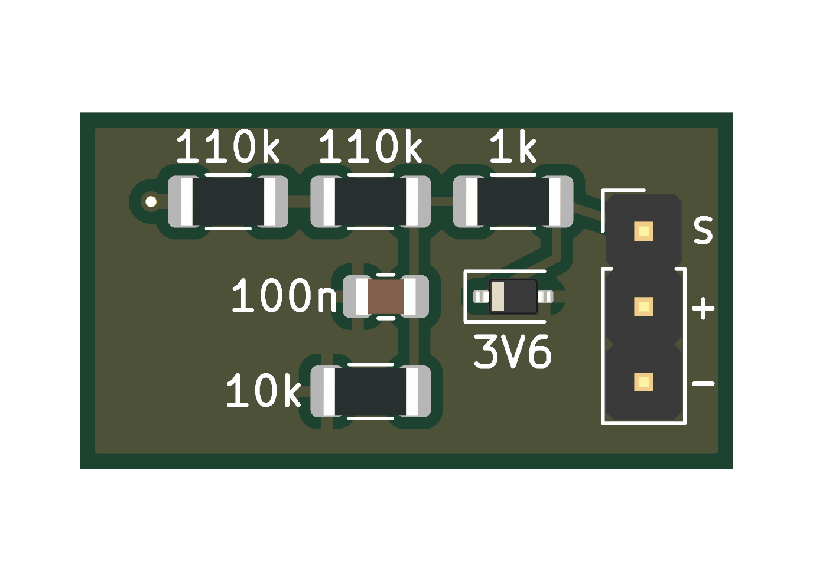
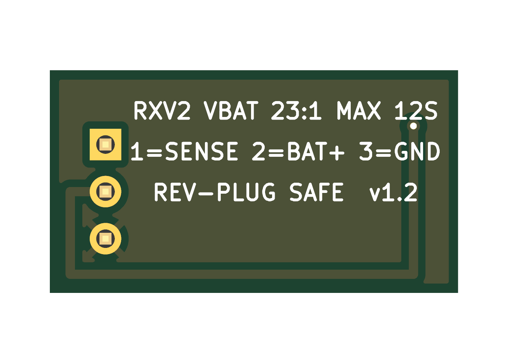

# The battery divider board (RXV2_VDIV v1.2)

A tiny board that lets the receiver read the **flight battery's voltage** itself, for a flight controller that does not
send it over CRSF telemetry. About 22 × 12 mm, two layers, 1.6 mm. Up to **12S**.

 

Drawn from its design files. The printing on the back says how to wire it.

## The files

| File | What it is |
|---|---|
| `RXV2_VDIV_v1.2_gerbers.zip` | **Send this to a PCB maker**: two layers, 1.6 mm |
| `RXV2_VDIV_schematic.pdf` | The circuit, to read without KiCad |
| `RXV2_VDIV.kicad_pro`, `.kicad_sch`, `.kicad_pcb`, `RXV2_VDIV.pretty`, `fp-lib-table` | The design, for KiCad |

KiCad's design check finds no errors and nothing unconnected.

## How it works

The flight battery's + goes through 220 kΩ (two 110 kΩ) and 10 kΩ to ground: a ratio of **23 to 1**, so a full 12S
pack (50.4 V) gives the receiver about 2.2 V. A 1 kΩ resistor, a 3.6 V zener and a 100 nF capacitor protect the
receiver's pad.

## Wiring it

- Its three pins: **1 = SENSE** (to the receiver's pad **D9**), **2 = BAT+** (the flight battery's +), **3 = GND**.
  The back of the board says the same. It is made so that a plug the wrong way round does no harm.
- **Only with one or two radios:** D9 is radio 3's pad.
- Then, in the app: **Receiver settings > Receiver battery**: Pin D9, Ratio 23.0, then **Save battery settings**.

Check the voltage it reports against a meter before you trust it.

Licence: boards CERN-OHL-S-2.0. See [../../../LICENSING.md](../../../LICENSING.md).
