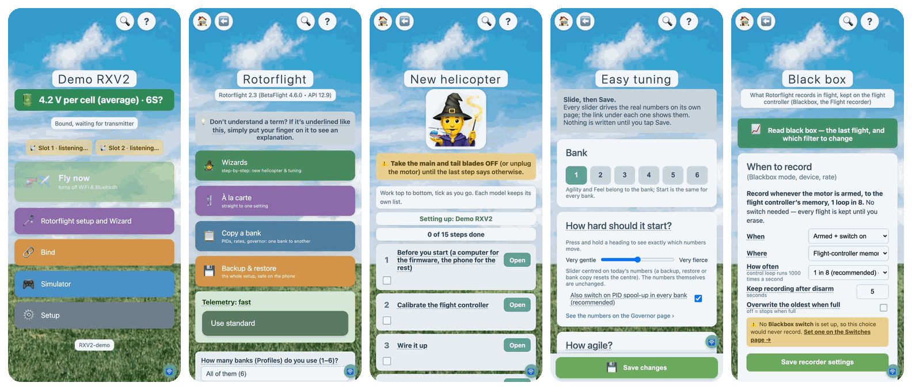

# The LDRC phone app (RXV2App)



<sub>The app's demo mode, which works with no hardware.</sub>

**Set up a Rotorflight helicopter from your phone, over Bluetooth, through an LDRC receiver or dongle.**

## Get it

- **iPhone and iPad:** [App Store](https://apps.apple.com/app/id6789857533) ("LockDownRadioControl RXV2"). iOS 16 or later.
- **Testers:** [TestFlight](https://testflight.apple.com/join/6yzhGxae) gets each new version first, often well before the App Store.
- **Android 8 or later:** the APK from [messiter.com/apps](https://messiter.com/apps/). It updates itself.
- **Free.** No adverts, no accounts, no tracking. Nothing is collected.

## What it does

- **Connect:** finds receivers and dongles nearby and shows their signal. One phone at a time per receiver.
- **The receiver's own pages**, carried over Bluetooth: wizards, PIDs, rates, governor, rescue, servos, filters, black box, backups, simulator controls.
- **Reviews:** a recording of each model, made at every connection, to look through indoors with everything off. Edits made there are offered as *Send to model* at the next connection.
- **Backups:** the whole Rotorflight set-up of each model, kept on the phone.
- **Demos:** the whole app on made-up data, as a receiver, a dongle or a simulator interface.
- **Updates the receiver** over Bluetooth, using the phone's own internet.

You need an LDRC receiver or dongle for anything but the demos. To build one: [Build one](https://messiter.com/ldrc/build.html), or the [dongle guide](https://messiter.com/rotorflight/dongle.html).

## How it works

- The receiver's web pages (`../RXV2/data/`) are **bundled in the app** (`webroot/`), so they load at once.
- Only the small requests (`/api/*.json` and the actions) cross Bluetooth, using an HTTP-over-Bluetooth framing to the receiver's NimBLE service (`../RXV2/src/BleConfig.h`). The same handlers serve WiFi and Bluetooth.
- **Bluetooth follows the receiver's flying rules:** it switches off when the model arms, along with WiFi, and comes back after landing.

## Build it yourself

**iPhone or iPad** (a free Apple ID is enough):
1. `cd RXV2App && xcodegen generate` (only after editing `project.yml`; the generated `RXV2App.xcodeproj` is committed).
2. Open `RXV2App.xcodeproj` in Xcode.
3. Target **RXV2App → Signing & Capabilities:** tick *Automatically manage signing* and choose your **Personal Team**.
4. Plug in the phone, pick it as the destination, press **Run**.
5. First time only, on the phone: *Settings → Privacy & Security → Developer Mode* on, then *Settings → General → VPN & Device Management*, and trust your Apple ID.

With a free Apple ID the app expires after **7 days** (press Run again), and you can have at most 3 such apps.

**Android:** the Gradle project is in `android/RXV2App` (open it in Android Studio).

**After changing the receiver's pages**, refresh the app's copy and rebuild:

```
rm -rf RXV2App/webroot && cp -R RXV2/data RXV2App/webroot
```

A stale copy still works: a page missing from the app is fetched from the receiver over Bluetooth.

## Licence

GPL-3.0-or-later, with an [app-store exception](../LICENSE-EXCEPTION.txt) that lets anyone, not just Malcolm, publish a fork on an app store, as long as its source is published too. See [../LICENSING.md](../LICENSING.md).
Copyright (C) 2026 Malcolm Messiter. Made with Claude (Anthropic's AI) as pair programmer.
