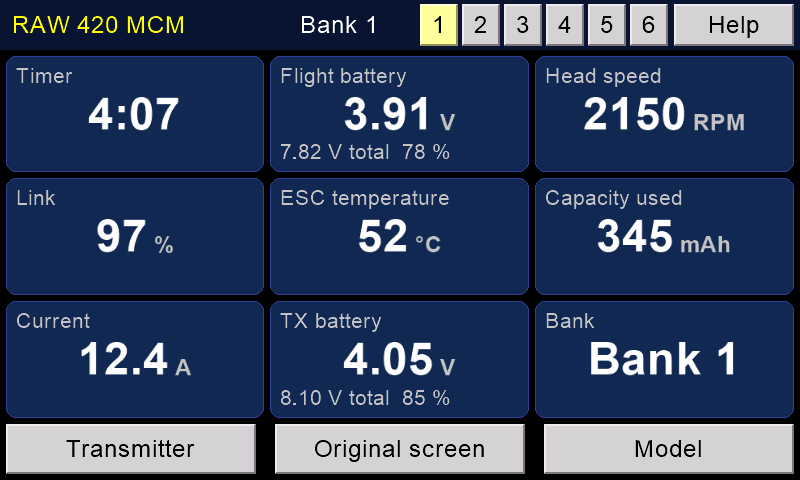
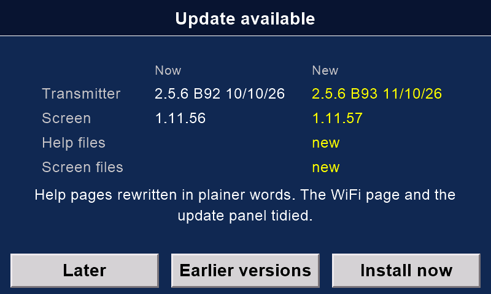

# The Version 2 transmitter's screen



<sub>A flight screen of your own: up to nine boxes, six designs on tabs. Drawn by this firmware's own code. Sample values.</sub>

**The screen is an Elecrow CrowPanel 5.0** with this firmware on it.

- **What the panel is:** an ESP32-S3 (WROOM-1-N4R8: 4 MB flash, 8 MB PSRAM), a 5-inch 800 × 480 display, GT911 touch, WiFi, Bluetooth, an NS4168 speaker amplifier, a microSD slot and a serial port on the back.
- **Buy the N4R8 version.** Not Elecrow's 16 MB 5-inch IPS panel: its pins differ, and this firmware would show a black screen.
- **What the firmware does:** it pretends to be the Nextion display that Version 1 used. The Teensy 4.1 sends the same display commands it always has (921,600 baud). The screen draws the transmitter's 76 pages from their definitions on its card, and answers with exactly the bytes a Nextion would.
- **On top of that it has pages of its own:** updates from the internet, WiFi, themes, flight screens, the picture chooser, Rotorflight's command line, and Pong.
- **It is also the Bluetooth link to the receiver.** All Rotorflight editing on the transmitter goes over it, not over the flying link.
- **Building a transmitter?** Start with [../TXV2/README.md](../TXV2/README.md) and [Build one](https://messiter.com/ldrc/build.html).

---

## Flash it once, then it updates itself

1. **Install** [PlatformIO](https://platformio.org/). The panel's USB-C port is a CH340 serial chip. A Mac or a Windows PC may need its driver.
2. **Put a blank microSD card**, formatted **FAT32**, in the panel's slot **before** you power it. The card is read at power-up only.
3. **Flash over USB**, before the screen is wired to the Teensy:

   ```
   cd TXV2-Screen
   pio run -e crowpanel50 -t upload --upload-port /dev/cu.usbserial-XXXX
   ```

   `pio device list` names the port. The panel resets itself, so no button-pressing is needed.
4. **First start.** With an empty card, the screen shows its update panel and says *No WiFi yet*.
   - Tap **WiFi setup**. Pick your network and type its password on the screen. The password is kept in the chip, never on the card.
   - The screen offers the latest release. Press **Install now**.
   - It fetches the whole card and the published firmware, then restarts as a complete screen. The help animations are most of
     the card (one for every help page), so the first fetch takes a while.
   - (Or copy `sd/` to the card first. It then fetches only what differs. The animations themselves, `sd/hmi/films/*.ldf` and
     their sound, `*.ima` (or `*.wav`), are not kept in this repository: they are large and remade from scripts, and the
     release on messiter.com carries them.)
5. **Connect it to the Teensy**, on the Version 1 board's Nextion header:

   | Screen port J10 (HY2.0, 4-pin) | Goes to |
   |---|---|
   | Pin 1: IO44, the screen's RX | Teensy pin 1 (TX1) |
   | Pin 2: IO43, the screen's TX | Teensy pin 0 (RX1) |
   | Pin 3: 3.3 V **output** | Nothing. Leave it unconnected |
   | Pin 4: GND | Ground |

   - Both sides are 3.3 V logic.
   - **Power the panel with 5 V through its USB-C socket** (a cut USB-C lead from the board's screen rail). The pins of its ports are outputs, not power inputs.
   - Find the cut lead's + and − with a meter: colours vary.
   - **Never two power supplies:** do not plug a computer into the USB-C socket while the screen is wired to the board.
   - The **speaker** goes on the SPK socket.
   - Why flash first: the serial port on J10 is shared with the USB chip. A USB cable would fight the Teensy.

From then on the transmitter updates itself: *Transmitter setup → Transmitter updates.*



<sub>The update panel. Nothing is installed until you press Install now. An illustration: the version numbers are examples.</sub>

---

## What is in this folder

| | |
|---|---|
| `src/main.cpp` | The emulator: the serial protocol, the pages and their parts, the script interpreter's host, drawing, touch, WiFi, the web tools, the workshop door |
| `src/*_device.h`, `src/*_draw.h` | The screen's own pages (update, wifi, pics, flight, theme, cli, pong) and the Bluetooth link (`ble_device.h`): the part that touches the hardware, and the drawing |
| `lib/Ldrc*` | The same pages' thinking, in portable C++ with no Arduino in it, tested on a Mac: `LdrcUpdate`, `LdrcWifi`, `LdrcPics`, `LdrcFlight`, `LdrcTheme`, `LdrcCli` (Rotorflight's command line through the receiver's USB cable), `LdrcBle` (the receiver's Bluetooth bridge, as the screen speaks it), `LdrcLink` (the framed file link to the Teensy, identical to the Teensy's copy) |
| `lib/NextionScript`, `lib/NextionFonts` | The interpreter for the pages' own event code, and the Nextion font format |
| `sd/` | **Everything on the screen's card:** `hmi/pages/*.json` (the pages), `hmi/pic/` (their pictures), `hmi/font*_aa.bin` (the fonts), `hmi/audio/` (the sounds), `hmi/web/` (the pages a phone sees), `images/` (model pictures) |
| `hmi/` | How `sd/` is made: `extract_hmi.py` decodes the Version 1 Nextion project, `build_sd.py` writes the card, `pagestyle.py` and `overrides.json` restyle the pages, `render_host/` draws any page on a Mac, `test_*/` are the host tests, `README.md` documents the Nextion file format |
| `dev/` | Tools used from a computer with the workshop door open: `teensy_ota.py` (the Teensy through the screen: hello, install, backup, restore, roll back), `screen.py`, `nextion_send.py`, `preview_page.py` |
| `platformio.ini` | The builds |

---

## Safety

- **The screen's radios are off whenever the model could be flying.** The Teensy says so on the wire (`ldrcst=`), and the screen obeys. That covers WiFi and Bluetooth.
- **No update, file transfer or firmware** is accepted while a model is connected.
- **The Teensy's new firmware installs on trial.** If it does not stay up, the old one comes back by itself.
- **The screen's own new firmware** must talk to the Teensy and rejoin WiFi, or it rolls back.
- **No passwords are published.** WiFi passwords are typed on the screen and kept in the chip.

## The workshop door

A published screen answers nothing on the network except `GET /status`, and accepts no firmware from a computer, until you open its **door**.

- **Open it:** press *Workshop door* in *Transmitter setup*, or hold the top-right corner of the screen for three seconds. Do the same again to shut it.
- It stays open on that one network only, and is shut on every other network. That keeps it safe on a club WiFi.
- With the door open, from the same WiFi:

```
pio run -e ota -t upload --upload-port <the screen's IP>     # firmware over the air
python3 dev/teensy_ota.py hello                              # the Teensy, through the screen
python3 dev/screen.py --help                                 # screenshots, pages, the log
```

- Every POST to the screen needs the header `X-LDRC: 1`.
- `/status` gives the screen's version, WiFi and card. `/bootlog` and `/recent` are its logs.

---

## The wire

Besides the Nextion protocol, a few words pass between the boards on the same serial line.

| Direction | Words | Meaning |
|---|---|---|
| Teensy → screen | `ldrcst=<bits>` | The transmitter's state: model connected, motor armed, safety, and so on |
| Teensy → screen | `ldrcrx=...` | The connected receiver's version and update progress, once a second |
| Teensy → screen | `pong=x,y,ly,ry`, `pong=start` | Pong's ball and paddles, once a frame. The screen draws it smoothly |
| Teensy → screen | `ldrcpipe on <id>`, `ldrcpipe off` | Open or close the Bluetooth link to the receiver with that ID |
| Teensy → screen | `ldrctx <words>` | A Rotorflight parameter packet, to send over the Bluetooth link |
| Teensy → screen | `ldrcreq <id> <path>` | A question for the receiver over the Bluetooth link (its raw Rotorflight line, above all) |
| Screen → Teensy | `ldrcpipe=<state>` | How the Bluetooth link is doing |
| Screen → Teensy | `ldrctel <item>:<hex> ...` | The receiver's answer, as telemetry items |
| Screen → Teensy | `ldrcrep <id> <code> <body>` | The receiver's answer to `ldrcreq` |
| Screen → Teensy | `ldrc update`, `ldrc rxupdate`, `ldrc wifi`, `ldrc appearance`, `ldrc colours`, `ldrc flight`, `ldrc defined`, `ldrc cli`, `ldrc diff`, `ldrc exec`, `ldrc door` | The screen's own buttons, placed on the Teensy's pages by `hmi/overrides.json` or its page generators. The screen acts on them itself |
| Screen → Teensy | `TIME=<epoch>` | The local time, from the internet. The Teensy sets its clock module from it |
| Screen → Teensy | `LDRCLINK` | Opens the framed file link (`lib/LdrcLink`): files on the Teensy's card, and firmware |
| Screen → Teensy | `LDRCRXUP major minor patch` | Orders the connected receiver to update itself |
| Screen → Teensy | `LDRCIMG <name>` | The picture chosen for the model |

## Tests and the renderer

- `hmi/test_all.sh` runs every host test and the release tool's gate. They need a C++ compiler, nothing else.
- `hmi/render_pages.py` draws every page with the screen's own drawing code on a Mac, so a change is seen before it goes near a transmitter.
- `hmi/lint_pages.py` looks for overlaps and clipped text.

## Builds in platformio.ini

| Build | What for |
|---|---|
| `crowpanel50` | **The published firmware**, flashed over USB |
| `ota` | The same, pushed over WiFi (door open) |
| `ota_dev` | A bench build that calls itself `dev`, so the transmitter always offers the published one over it |
| `ota_test_fail_trial`, `ota_test_fall_over` | Builds meant to fail, to prove the roll-back |
| `ota_seed`, `usb_seed` | Malcolm's bench builds. They need an `include/secrets.h` with his networks, which is never published. **Use `crowpanel50`** |

## Licence

- Code: GPL-3.0-or-later. The screen's pages, pictures and sounds: CC BY-SA 4.0. See [../LICENSING.md](../LICENSING.md).
- Third-party libraries (Arduino GFX, SensorLib, ArduinoJson, NimBLE-Arduino) keep their own licences.

Copyright (C) 2026 Malcolm Messiter. Made with Claude (Anthropic's AI) as pair programmer.
