# The Version 2 transmitter

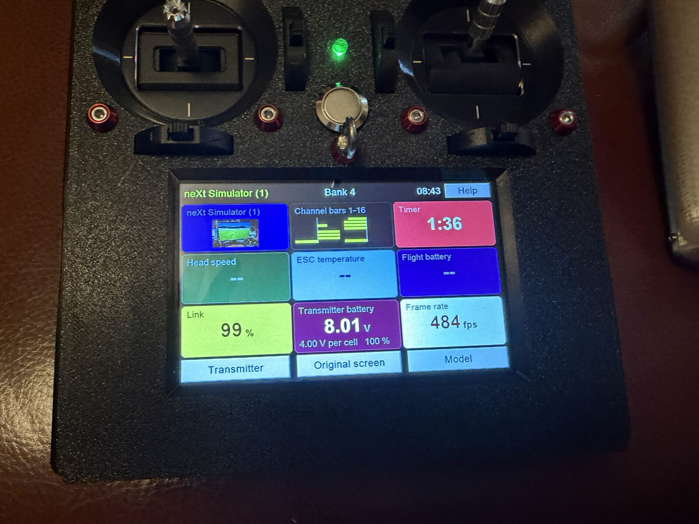

<sub>A Version 2 transmitter, showing one of its front screens.</sub>

**A 16-channel 2.4 GHz transmitter that you build yourself.**

- **The main board flies the model.** A Teensy 4.1 reads the sticks, does the mixing and runs the radio link.
- **The screen talks to the pilot.** Elecrow's 5-inch IPS panel (ESP32-S3 with 16 MB, touchscreen, WiFi, Bluetooth) draws the pages and fetches updates. Its firmware is in [../TXV2-Screen](../TXV2-Screen).
- **It is Version 1 with a new screen and a new case front.** The main board, radio, sticks and switches are Version 1's.
- **Have a Version 1?** Your models, main board, sticks, switches and case back stay (fill the back's old charger hole with epoxy resin). Print the Version 2 case front from [STL files/V2](STL%20files/V2): it holds the new screen. Fit the screen, and update the firmware. Keep your Teensy's own card (copy it to a computer first). Do not make the example card.
  <!-- (10 Nov 2026, Malcolm: "A version one back is okay, except it has an unnecessary hole for the old style charger, but it can be used if this hole is blocked up with epoxy resin".) -->
- **Building one?** Start with [Build one](https://messiter.com/ldrc/build.html) on the website. This README has the same steps, with the files. **Nothing to compile:** the Teensy takes a ready-made file, and the screen is flashed from a web browser.

---

## What it does

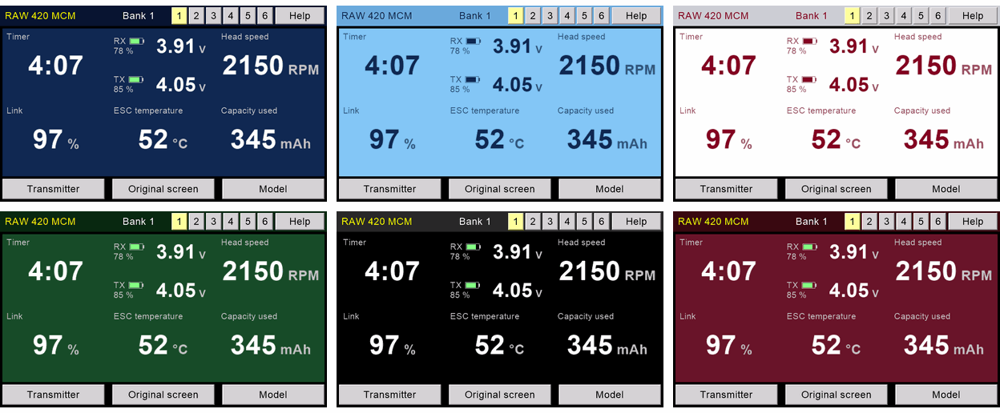

<sub>One front screen in six of the twelve themes. Sample values.</sub>

**Flying**
- 16 channels. Any stick, switch or knob can drive any channel.
- 4 banks (flight modes), or 6 with **Six banks** on (Model options), each with its own curves, trims and mixes. With a Version 2 receiver, the phone app follows the transmitter's count.
- Curves of 3, 5, 7 or 9 points for every channel in every bank (every point keeps its height when you change the count), 3 rates, 32 mixes, 8 timed macros, servo speed, subtrim, reverse, failsafe.
- **Eight switches, any job:** banks, motor, safety, rates, buddy, or the input of any channel 5–16.
- **Wireless buddy box** with no extra hardware, and a "nudge" mode for the instructor.

**Model memories**
- 90 model memories, and as many backups as the card holds.
  <!-- TODO Malcolm: 90 memories: the code (MAXMODELNUMBER 91: the Models page, automatic model selection and the buddy match run 1-90) and MODELS.TXT say 90. Only the Check IDs page (Model_IDs.h) scans 1-89: please check memory 90 shows there. -->
- **The right memory loads by itself** when you switch a model on. This is rare: elsewhere we found it only on Multiplex's SMART SX, with its ID receivers (some have a fixed ID, some can be set), and on Mikado's VBar Control, which keeps each model's settings in the model.
- **Check for duplicates** lists every model with its stored ID, and names any two that share one.
- **Send a model memory to another transmitter** over the radio link. A Version 1 transmitter can send its models to a Version 2 over the air (tested), and two Version 2s swap them.

**The screen**
- **Six front screens, ready-made and yours to change:** an overview, head speed, the timer, the link, power, and the model with its channels. One to nine boxes each, in big numbers or round dials, with amber and red zones.
- **Twelve colour themes**, each one editable. Give each box its own theme, or press **Apply to all boxes** to give the whole screen one.
- **Model pictures** sent from your phone by scanning a QR code.
- **See what moves what:** the Inputs and outputs page and the Switches page light the stick, trim or switch you move.
- **Help on every page:** 72 help pages in plain words. Most have an **animation** of the page in use, with a spoken voice. There are 76 animations; ten of them, under **Fix problems**, cure common helicopter problems.
- Spoken messages, log files, and Pong for rainy days.

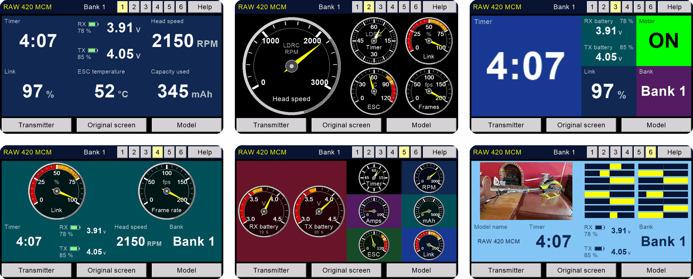

<sub>The six ready-made front screens. Use them as they are, or change any box. Sample values.</sub>

<p>
  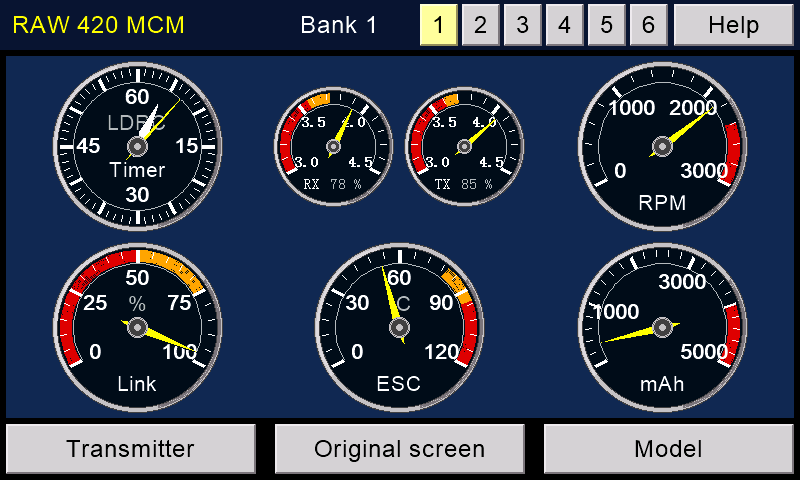
  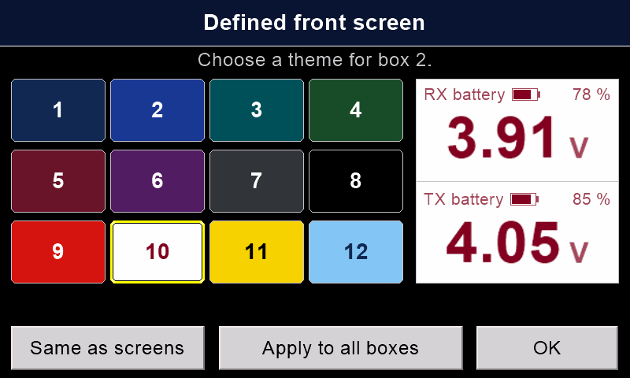
</p>

<sub>Left: a front screen of round dials, each with its amber and red zones. Right: give a box its own theme, or apply it to all boxes. Sample values.</sub>


**Rotorflight on the transmitter** (needs a Version 2 receiver)
- Easy tuning, PIDs, rates, governor, rescue, servos, travel extents, filters, switches and knobs, copy a bank, battery, black box, calibrate, first-time basics. On the 16 MB screen, the beeper and Rotorflight's name for the model too.
- **A new helicopter, step by step** (16 MB screen). The **New helicopter guide** takes you through every set-up step in order and ticks each one off. **Check my setup** lists anything unfinished and says what stops the model arming. **Direction check** tells you whether the flight controller is the right way round.
- **Back up the Rotorflight tune and set-up**, every bank, to the card, and put it back exactly. Ports, LED, GPS and ESC settings are not included. **Copy tuning** writes another model's PIDs, rates, governor and rescue from its backup into this one.
- **What changed?** (16 MB screen) compares the whole set-up with its backup, setting by setting, and puts any one setting back. **Undo the last save** takes back a save. We did not find this comparison on any other radio.
- **Edit with the model switched off.** The changes go across when it next connects.
- **Every save is read back** from the flight controller and compared with what you typed, before the page says saved. A difference, or no answer, is told.
- With the receiver's USB cable to the flight controller: setting up the selectors and knobs on Switches and knobs (they then work without the cable), Rotorflight's command line, and the whole set-up saved to the card as text (Rotorflight's `diff all`).
- The settings travel over Bluetooth from the screen to the receiver, never over the flying link, and only while the model is disarmed.

<p>
  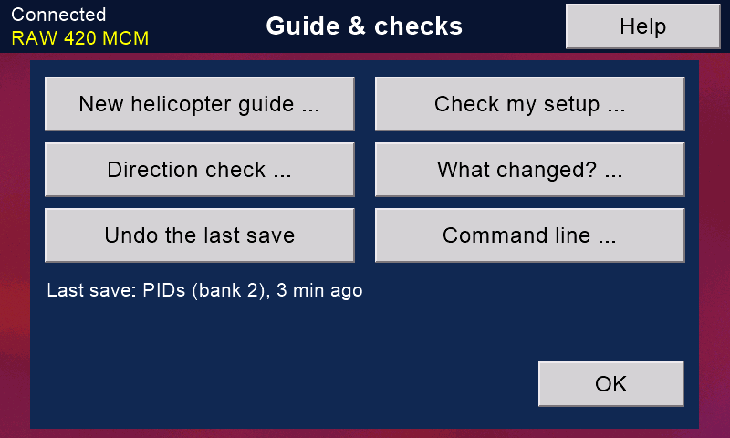
  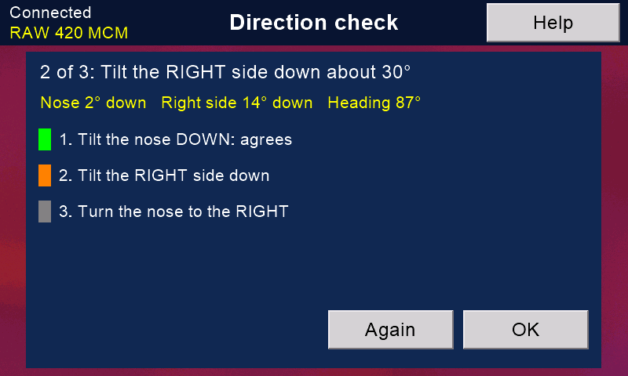
</p>

<sub>Left: Guide &amp; checks, five helpers and the command line. Right: Direction check, as you tilt the model. Sample values.</sub>

<!-- TODO Malcolm: compare.md says Battery, Black box and Calibrate (B88) were not yet tried on hardware on 10 Oct. Confirm before release notes call them proven. -->

**Link and diagnostics**
- Packets a second, lost packets, longest gap, swaps between the receiver's radios.
- A chart of reconnection times, and a scan of the 2.4 GHz band for interference.

**Updates and safety**
- **One button updates the whole transmitter** from the internet: screen, card, main board, help texts. It tells you when a new version is ready.
- **The receiver can be updated through the transmitter.**
- Nothing changes in flight. No transmitter update, file transfer or restart starts while a model is connected. A receiver update runs only with the safety on, and the receiver refuses while armed. WiFi and Bluetooth switch off whenever the model could fly.
- Switch a Rotorflight model on with the safety already off, and the transmitter will not connect to it until the safety is on.

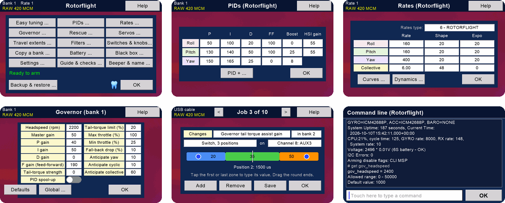

<sub>Rotorflight set-up on the transmitter. Sample values.</sub>

---

**What gets used.** Compare feature lists and every radio has something the others lack. What matters is which features a pilot reaches for. The ones above that most systems do not have - a model that loads itself, a model or the controls handed over the air with nothing extra to buy, the whole radio updated from a button, Rotorflight set up from the transmitter - are wanted at the field all the time. The few things other radios have that this one does not are rarely used by anyone, and since every line is open they can be added the day a pilot asks: the 3-, 7- and 9-point curves were asked for one October morning and were in the transmitter by lunch.

## What is in this folder

| | |
|---|---|
| `TransmitterCode/` | The Teensy 4.1 firmware (PlatformIO). `include/` holds nearly all of it, one header per subject. `src/main.cpp` is set-up and the main loop |
| `TransmitterCode/SD Examples/Teensy SD Example/` | What goes on the Teensy's microSD card |
| `Help files for SD/` | The help texts (74): one for each of the 72 help pages, and two kept for reference |
| `Noises/` | The sounds: voice messages, prompts and sound effects |
| `Circuits/` | The circuit boards as Proteus projects, with Gerbers in the `CADCAM` folders. `Transmitter - CADCAM` is the transmitter's main board. The `Receiver` and `SensorHub` folders are Version 1's receiver boards |
| `STL files/` | The printed case. `STL files/V2/` holds the Version 2 parts. The rest are the Version 1 parts that Version 2 shares. STEP sources in `STL files/STEP files/` |
| `Images/` | Photographs |
| `dev/` | Malcolm's tools: the release tool, the firmware packager, the publisher of this folder |
| `V1B-UPDATES.md` | The change log, newest first. Version 2 was called "V1B" while it was being made |

---

## Parts

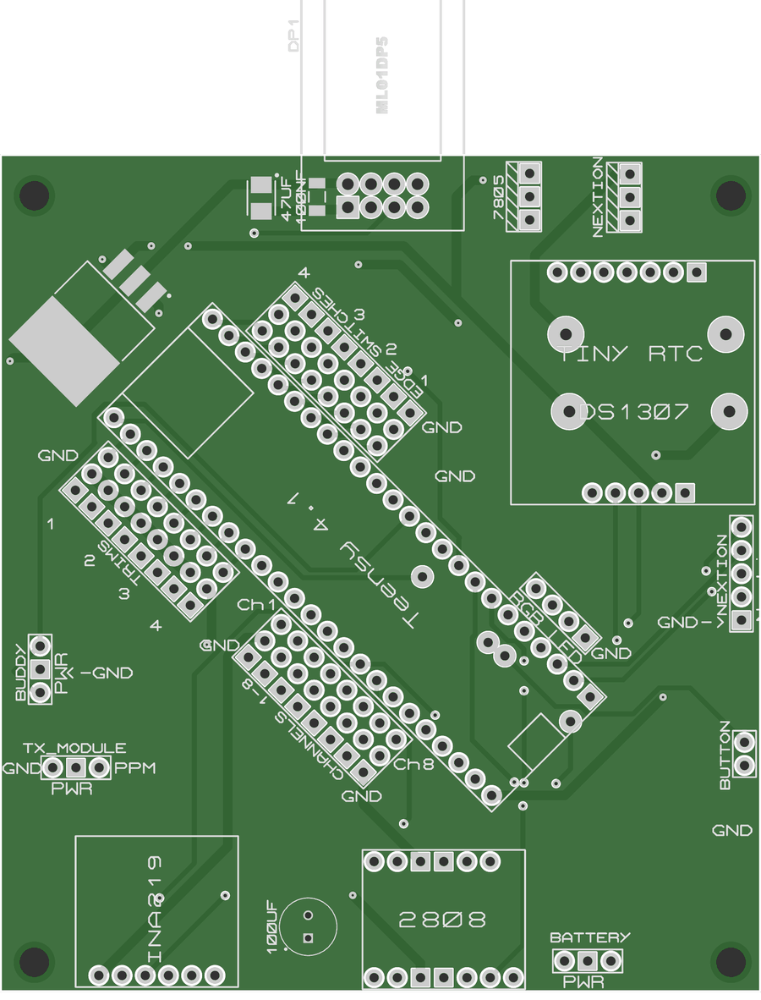

<sub>The main board, drawn from the Gerbers in `Circuits/Transmitter - CADCAM`. The same board flies Version 1 and Version 2.</sub>

| Part | What to buy | Qty | Notes |
|---|---|---|---|
| Main board | Printed circuit board from the Gerbers in `Circuits/Transmitter - CADCAM` | 1 | 2 layers, about 83 × 91 mm. Any PCB maker |
| Microcontroller | PJRC **Teensy 4.1** | 1 | |
| Radio | Ebyte **E01-ML01DP5** (nRF24L01+ with amplifier) | 1 | In a 2 × 4 socket. Its aerial socket is **SMA**. It needs a capacitor across its power and ground pins (below) |
| Screen | **Buy the 16 MB screen:** Elecrow's **5-inch IPS panel, SKU DLE06050B** (ESP32-S3 N16R8: 16 MB flash, 8 MB PSRAM). New features need it. The older **CrowPanel 5.0" ESP32 HMI, SKU DIS07050H, N4R8** (4 MB flash) is full: it gets fixes only, no new features. Do not buy it | 1 | The firmware tells the two apart by itself; print the case front for the one you have. Not Elecrow's "Advance" series: its card slot is on other pins |
| microSD card | For the Teensy. FAT32 or exFAT | 1 | |
| microSD card | For the screen. **FAT32** (cards over 32 GB come as exFAT: reformat them) | 1 | The screen fills it itself |
| Power switch | **Pololu 2808** pushbutton power switch | 1 | |
| Push button | 16 mm vandal-resistant, momentary | 1 | The on/off button |
| 5 V regulator, Teensy | Pololu 5 V 1 A step-up/step-down **S13V10F5** (the 2 A **S13V20F5** fits too: 1 A is plenty) | 1 | Step-up/step-down: it holds 5 V even when the pack runs low, so the radio link keeps flying the model if the screen drops out first |
| 5 V regulator, screen | **7805** | 1 | No heatsink needed |
| 3.3 V regulator | **AMS1117-3.3** | 1 | |
| Battery sensor | **INA219** current/voltage sensor module (I²C), such as the common purple **GY-219** (its A0 and A1 pads left open: address 0x40) | 1 | Needed: without it the transmitter cannot read its own battery |
| Clock | "Tiny RTC" **DS1307** module with a coin cell | 1 | Use its **left** 5-pin header, and leave its 7-pin row unconnected. It needs **5 V** to answer. The screen sets it from the internet |
| Sticks | **FrSky M9** Hall-sensor gimbals | 2 | |
| Trims | **FrSky trim switches**, X9D Plus spare part | 4 | |
| Top switches | Three-position switches made for RC transmitters, with a long lever (single pole, three tags; the middle position connects nothing: ON-OFF-ON) | 4 | Several brands make them |
| Front controls | The same three-position switches, or 10 kΩ linear knobs (potentiometers, often marked B10K) | 4 | Any mix |
| Status light | **KY-016** RGB LED module (a 5 mm common-cathode RGB LED on a small board, its resistors already fitted) | 1 | Its pins are marked R, G, B and −. On the board's RGB LED header, GND is the end pin that beeps to the battery's −; then red, green, blue |
| Speaker | 8 Ω (or 4 Ω), 1–2 W | 1 | On the screen's SPK socket (JST PH 2.0, 2-pin) |
| Battery | 2S: LiPo, Li-ion or LiFePO4. Malcolm uses RadioMaster's 2S Li-ion 21700 pack, 5000 mAh | 1 | Always two cells. RadioMaster's 6200 mAh pack fits too |
| Charger | A small USB-C charger board on the **IP2326** chip, such as the **LX-LISC-V3** (its name is on the back), in the charger bay on the back, and a red LED for its charge light | 1 | The LX-LISC-V3 comes set for two cells: change nothing (the Chinese words on it say how to make it charge three cells: do not). Its B+, BM and B− go to the pack's 3-pin balance plug (JST-XH). For a LiPo or Li-ion pack: a LiFePO4 pack needs a LiFePO4 charger |
| Diodes | 1N5406 ×2, 1N4001 ×2 | 4 | |
| Capacitors | Electrolytic 330 µF ×1, 100 µF ×1, and one for the radio module (Malcolm uses 220 µF; the value is not critical). Tantalum 330 µF (0E907) ×2, 47 µF 1206 ×2. Ceramic 1206: 330 nF ×2, 100 nF ×4, 10 µF ×1 | 14 | The radio's one goes across its power and ground pins, the striped leg (minus) to GND |
| Aerial | 2.4 GHz aerial with an **SMA** plug (a pin in the middle) and a 20 cm SMA male-to-female extension | 1 | **Not RP-SMA.** Most WiFi aerials are RP-SMA: they screw on, but do not connect |
| Screen leads | A USB-C lead to cut up (5 V into the screen). An HY2.0 4-pin lead (the screen's serial port) | 1 each | |
| Connectors | Male and female headers, 3-row headers, a 2 × 4 socket, servo cable, DuPont 3- and 4-pin | Various | |
| Case | Printed in PETG (or what you prefer) | 1 set | See below |
| Fixings | Tiny flange-head self-tapping screws (photo below), M3 bolts and lock-nuts, 2 mm cable ties, 5-minute epoxy | Various | The tiny screws hold the screen, the charger board and the case back: buy plenty |

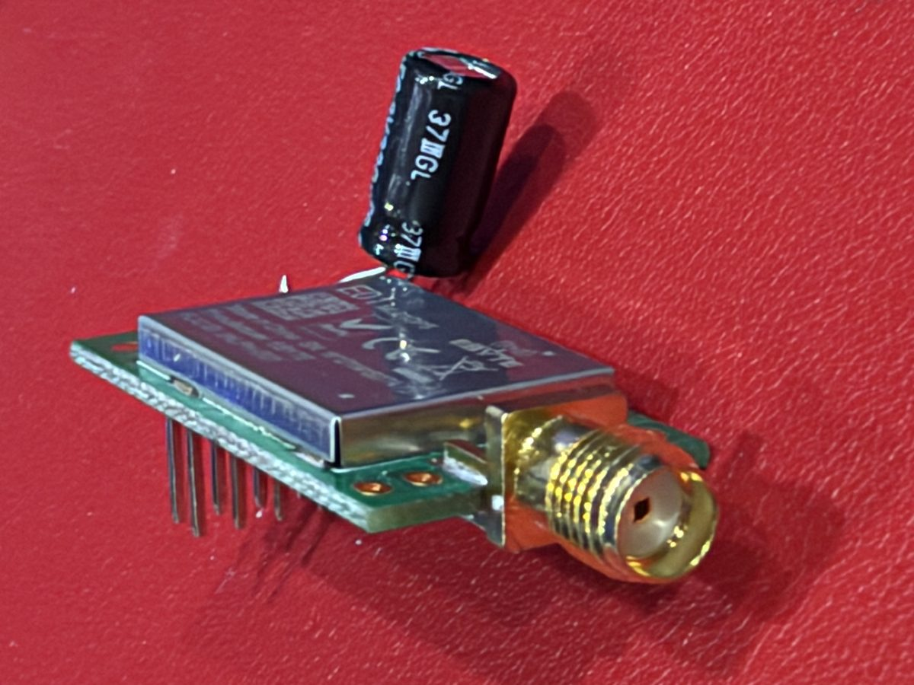 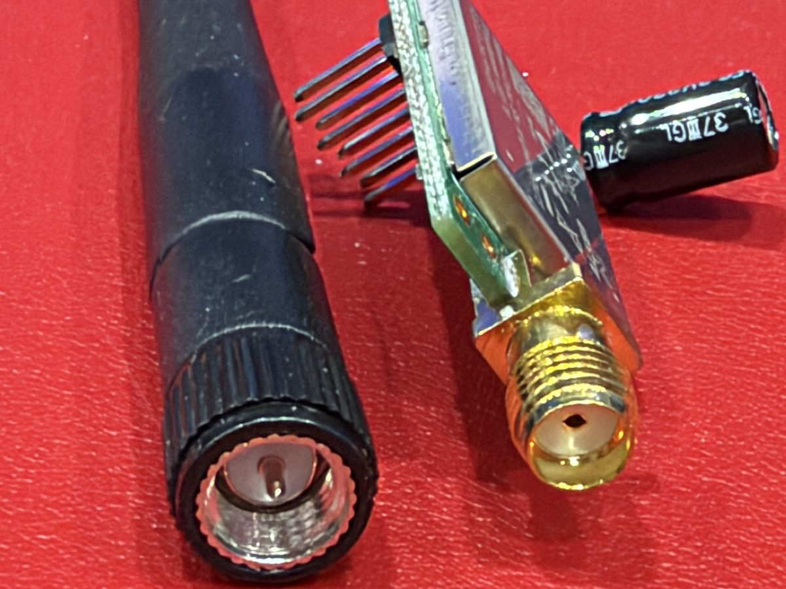

<sub>The radio, its capacitor soldered across its power and ground pins. SMA: the aerial's plug has a pin in the middle, the radio's socket a hole.</sub>

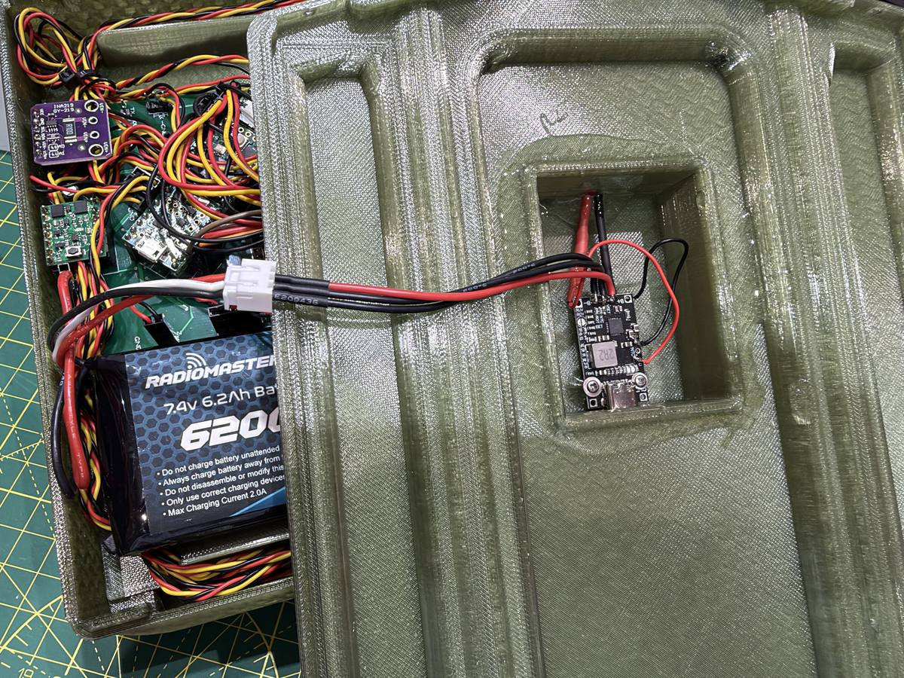

<sub>The charger in its bay on the case back, joined to the pack's balance plug (white).</sub>

**Cost:** over £120 in parts (approximate, October 2026; the full total is coming). See [Build one](https://messiter.com/ldrc/build.html) for current figures.

<!-- TODO Malcolm: (1) RGB LED: ANSWERED 10 Nov 2026 - a KY-016 module, "comes complete with all resistors fitted" (Malcolm); common cathode (the firmware); the header RG1: 1 = GND, 2/3/4 = red/green/blue (the netlist). (2) 5 V regulators: ANSWERED 3 Nov 2026 (a step-up/step-down Pololu for the Teensy - S13V10F5, 1 A is plenty, or S13V20F5 - and a 7805 for the screen, no heatsink needed). (3) INA219: ANSWERED 10 Nov 2026 - needed on every build (Malcolm); his is a GY-219 (his photo). (4) Charger ANSWERED 10 Nov 2026 with photos (an IP2326 board, LX-LISC-V3; it comes 2S; B+/BM/B- to the balance plug; a red LED in the bay); the charge light's wiring (a resistor?) still wanted. (5) ANSWERED 10 Nov 2026 with two photos: SMA (the module's socket has a hole, the aerial a pin), and a capacitor across the module's power and ground, 220 µF, "its value does not appear to matter much". (6) Battery ANSWERED 10 Nov 2026 (RadioMaster 2S Li-ion 21700 5000 mAh, HP157-BATT-5A2S; their larger one fits too); the speaker part still wanted. (7) ANSWERED 10 Nov 2026: all three-position, made for RC transmitters, several brands. (8) Re-cost the V2 parts. -->

### The case

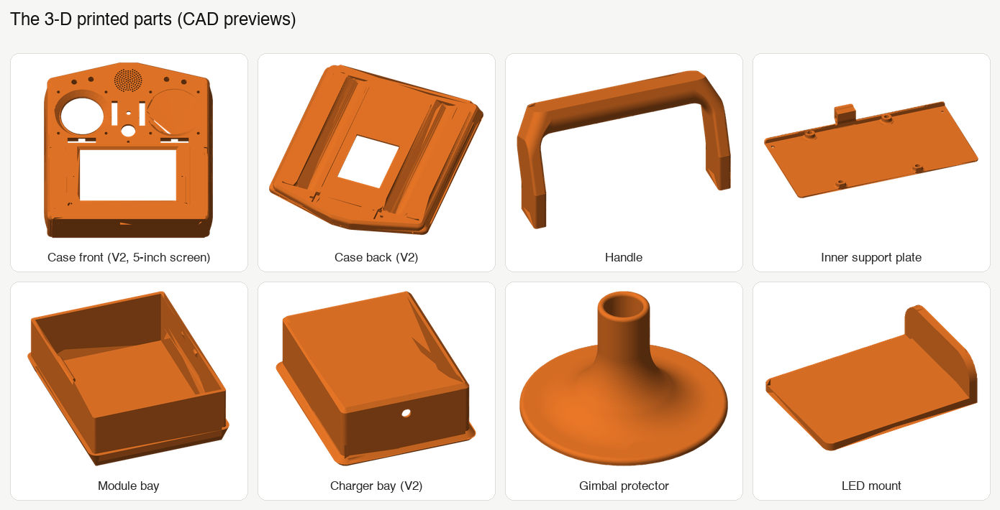

<sub>The printed parts. Previews drawn from the CAD files.</sub>

- **Version 2 parts** in [`STL files/V2`](STL%20files/V2): **two case fronts**, one for each screen (`TXV12_FRONT_16m_V2.step` for the 16 MB IPS panel, `TXV12a_Front_4meg_V2.step` for the 4 MB CrowPanel: their dimensions differ slightly), the case back `TXV12a_BACK_V2.step`, and the charger bay `CHARGERBAY.stl`, which takes the place of Version 1's JR module bay on the back and holds the USB-C charger module. The fronts and the back are STEP files; most slicers open them directly.
- **Shared with Version 1** in `STL files/`: `TX_HANDLE`, `TX_SUPPORT`, `GimbalP` (gimbal protector), `LEDMOUNT`, `SPACER`. (`MODBAY` and `Blank` are Version 1's JR module bay: a Version 2 prints the charger bay there instead.)
- `TX_FRONT.stl` and `TX_BACK12.stl` are **Version 1's** (cut for the old Nextion screen). Do not print them for a Version 2.
- The screen has no mounting holes. Four tiny self-tapping screws hold it in the case front; the same screws hold the charger board and the case back, so buy plenty.
- **Printing** is not critical: Malcolm uses 0.16 mm layers and the slicer's default infill.

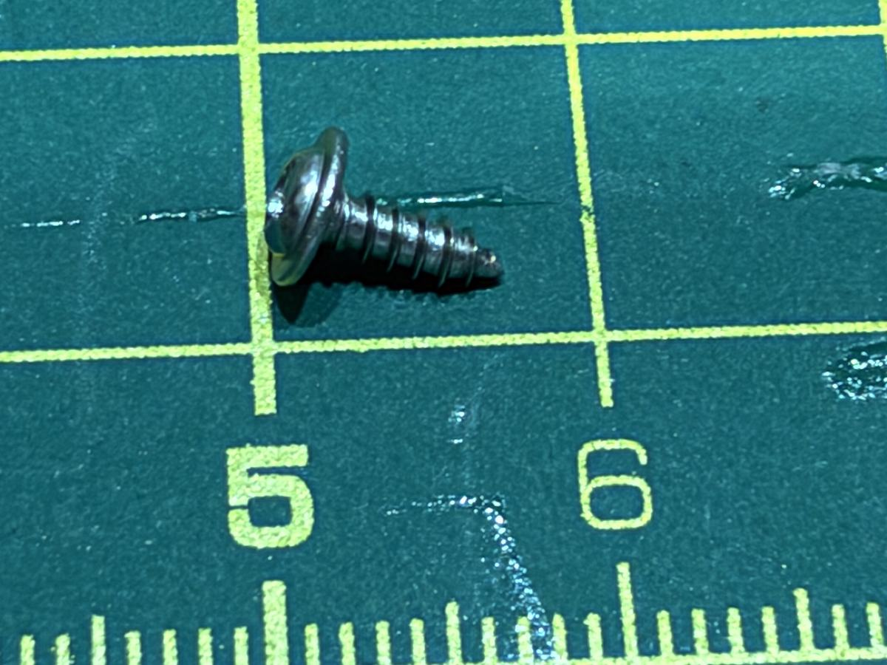

<sub>One of the tiny self-tapping screws, on a centimetre grid.</sub>

<!-- (10 Nov 2026, Malcolm: layer height and infill "not important"; he uses 0.16 mm and the default infill. Four tiny screws hold the screen; the same screws hold the charger and the case back.) -->

---

## Build it

> [!WARNING]
> **Radio rules.** The radio modules that transmit and receive, Ebyte's E01-ML01DP5 (transmitter) and E01-ML01SP4 (receiver), carry the CE mark and FCC ID 2ALPH-E01. They run at about 100 mW (20 dBm), the UK and EU limit for 2.4 GHz; an aerial cannot add power, it only shapes where the signal goes. As with any model you build yourself, check the radio rules where you live before you fly.

Work in this order. Each step ends with a check.

1. **Order the main board.** Send the Gerbers in `Circuits/Transmitter - CADCAM` to any PCB maker.\
   *Check:* the board matches the picture above.
2. **Print the case.**\
   *Check:* the screen, sticks and switches fit their holes before you wire anything.
3. **Flash the screen first, by USB, before it is wired in.** Its serial port is shared with its USB chip, so do it while the USB socket is free. Follow [../TXV2-Screen/README.md](../TXV2-Screen/README.md).\
   *Check:* the screen joins your WiFi, fills its card and restarts as a complete screen.
4. **Flash the Teensy on its own, by micro-USB, before it goes on the board.** See [Flash it, once](#flash-it-once), step 1.\
   *Check:* Teensy Loader says **Reboot OK**.
5. **Solder the small parts:** the surface-mount (SMD) parts first, such as the 1206 capacitors; after that the order is up to you: the diodes, regulators, sockets and headers. Then fit the Pololu 2808 power switch, wire the push button, and fit the battery lead (BATTERY header). Power the main board only ever from its battery, switched on by the button and the 2808.\
   *Check:* battery off: the resistance across the battery plug is not near zero. With the meter on volts across the battery's own plug, the pin that meets the board's + reads plus 6 to 8.4 V. Then connect the battery, switch on, and measure 5 V on the Teensy socket's VIN, 5 V on the screen header's middle pin and 3.3 V on the radio socket's VCC.
6. **Fit the modules:** first solder a capacitor across the radio's power and ground pins (VCC and GND; Malcolm uses 220 µF, the value is not critical; the striped leg to GND), as in the photo above. Then the flashed Teensy 4.1, the ML01DP5 radio, the INA219, the clock (its left, 5-pin header only; 5 V). Screw the aerial and its extension onto the radio now: it transmits at full power from switch-on, and with no aerial its amplifier can be damaged. Both must be **SMA**: an RP-SMA aerial screws on, but does not connect.
7. **Wire the controls** (pins in the table below):
   - **Sticks: wire them as for Mode 1**, whatever mode you fly. The firmware swaps them for Mode 2. Only the springs change: in Mode 2 the left stick's up-and-down stays where you leave it (the throttle), and the right stick's springs back to the centre.
   - Trims, the four top switches, the four front controls and the RGB LED.
   - A knob (potentiometer; 10 kΩ works well) has its ends on 3.3 V and ground and its wiper on the pin.
8. **Wire the screen** to the old Nextion header:
   - Teensy **pin 1 (TX1)** → screen port **J10 pin 1** (IO44, the screen's RX).
   - Teensy **pin 0 (RX1)** ← screen port **J10 pin 2** (IO43, the screen's TX).
   - **Ground** to J10 pin 4. **Leave J10 pin 3 unconnected**: it is a 3.3 V *output*.
   - **5 V** from the board's screen rail (the Nextion header's pin 3) through a cut USB-C lead into the screen's USB-C socket. The screen takes power only through USB-C.
   - The **speaker** on the screen's SPK socket.
   - Pin 1 of the board's screen header is GND: the end pin nearer the bottom of the transmitter. Then pin 2 (not used), pin 3 in the middle (5 V), and pins 4 and 5 (the Teensy's transmit and receive). Check pin 1 with a meter on beep, battery off: it beeps to the battery's −.
   - **Never two power supplies:** do not plug a computer into the screen's USB-C socket while it is wired to the board.
   - *Check:* both sides are 3.3 V logic. TX goes to RX, RX to TX.
9. **Make the Teensy's card** ([Flash it, once](#flash-it-once), step 2).
10. **Switch on.** First check the resistance across the battery plug again (not near zero). Then do the first start (below).

<!-- TODO Malcolm: (0) ANSWERED 10 Nov 2026: "the main board is only ever powered from its battery. By using the combination of the button and the 2808". (1) Front three-position switches on the analogue pins A6-A9: what resistor values? (2) Top switches: ANSWERED 10 Nov 2026 (three-position switches made for RC transmitters, several brands; the centre tag to ground is the firmware's own requirement). (3) + (4) ANSWERED 10 Nov 2026: "No parts are obsolete and that gerber is the correct one." (5) Photos of the inside for this section. -->

### Teensy pins

| Teensy pin | Goes to |
|---|---|
| 0, 1 (Serial1) | The screen (921,600 baud) |
| 2, 3, 4 | RGB LED: red, green, blue |
| 5 | Power off (Pololu 2808) |
| 7, 8 + SPI | Radio: CE, CSN |
| 18, 19 (I²C) | INA219 (0x40) and the clock (0x68) |
| 25–32 | The four top switches, two pins each |
| 33 | The power button (sensed) |
| 34–41 | The four trims, two pins each |
| A0–A3 | The sticks (channels 1–4) |
| A6–A9 | The four front controls (channels 5–8) |

---

## Flash it, once

After this, the transmitter updates itself. **There is nothing to compile.**

> [!WARNING]
> **Never power the transmitter from the Teensy's USB.** Flash the Teensy before it goes on the main board. If it is already fitted, use a USB lead with its red (5 V) wire cut, and power the transmitter from its own battery.

<!-- ANSWERED 10 Nov 2026, Malcolm: "It is not a good idea to power the transmitters, teensy, from its USB. It's better to connect a USB with the red wire cut, and apply power from the battery." The question was: confirm the VUSB/VIN advice. The Teensy 4.1 joins USB 5 V to VIN unless that pad is cut (PJRC's advice); with the board's 5 V rails on VIN, USB could back-feed the rails and the screen. Is the pad cut on your boards, or do you never plug USB into a fitted Teensy? Until you say, this README and the website flash the Teensy off the board. A Version 1 owner's Teensy is already fitted: should they lift it out of its socket for the first Version 2 flash? -->

1. **Flash the Teensy on its own**, plugged into your computer with a micro-USB **data** cable:
   - Download [`ldrc-v2-teensy41.hex`](https://messiter.com/txv1b/release/ldrc-v2-teensy41.hex). That link always gives the latest release.
   - Install PJRC's free [Teensy Loader](https://www.pjrc.com/teensy/loader.html) (Mac, Windows or Linux). On Linux, install PJRC's udev rules first (the Teensy Loader page has them).
   - Open Teensy Loader. Choose **File**, then **Open HEX File**, and pick `ldrc-v2-teensy41.hex`.
   - Press the small white button on the Teensy.
   - In the loader, press **Program**, then **Reboot**. With its **Auto** button on, it does both by itself.
   - *Check:* Teensy Loader says **Reboot OK**.

   **Prefer to build it from source?** Install [PlatformIO](https://platformio.org/) (the VS Code extension, or the `pio` command), then:

   ```
   cd TXV2/TransmitterCode
   pio run -e teensy41 -t upload
   ```

   PlatformIO fetches the libraries and runs the Teensy loader. If it sits waiting, press the small white button on the Teensy. It ends with `SUCCESS`.
2. **Make the Teensy's card.** Copy everything in `TransmitterCode/SD Examples/Teensy SD Example/` to its microSD card: `help/`, `Images/`, `mod/` and `MODELS.DAT`. Add an empty folder called `log`.
   - The example `MODELS.DAT` holds Malcolm's models. Start with them, or reset (below) and make your own.
   - (Version 1 owner: skip this. Keep your own card.)
3. **Flash the screen** as [../TXV2-Screen/README.md](../TXV2-Screen/README.md) says, if you have not already.

---

## First start

1. **Reset the transmitter** (a new transmitter only): *Transmitter setup → Calibrate → Reset transmitter.* It takes a few minutes. It deletes the model memories (not their backup files) and sets Mode 2.
2. **Set the stick mode** (1 or 2), and **switch Automatic model selection on**: *Transmitter setup → System → General.* Reset transmitter switches it off. Press **OK** to save (Next does not save the page).
3. **Calibrate:** *Transmitter setup → Calibrate.* Press **Calibrate sticks etc.**, move every stick and knob to its ends a few times, press **Next**, centre everything, push the four top switches away from you, press **Finish**. Redo this after changing sticks or mode.
4. **Calibrate the trims**, so each one works the right way.
5. **Set the battery type** (LiPo, Li-ion or LiFePO4), so the percentage is right.
6. **Join WiFi:** *Transmitter setup → WiFi.* Type the password on the screen. A phone hotspot works at the field. On an iPhone, switch on **Maximise Compatibility** (the screen uses 2.4 GHz only).
7. **Give the switches their jobs:** *Transmitter setup → Switches.*
8. **Bind a receiver:**
   - **Blades or propeller off, safety on**, before the model is switched on.
   - Put the receiver in bind mode. A new receiver is in bind mode already: its light flashes twice a second.
   - Hold the transmitter's power button for 2–5 seconds while switching on. It chirps and says "binding enabled". (Or *Transmitter setup → System → General → Bind.*)
   - Choose an empty model memory first. When the transmitter asks to save the receiver's ID, press OK (Cancel saves nothing, and the model does not connect). Check it on *Model setup → Model IDs*. From then on the transmitter loads it by itself.
   - Every receiver bound to this transmitter obeys it: **switch on one model at a time.**

---

## Test before you fly

Blades off for every test. Unplug the motor too, unless the test needs it. The full list is on [Build one](https://messiter.com/ldrc/build.html).

- **Link:** *Model setup → Telemetry.* About 500 packets a second. The longest gap should be well under 100 ms; above about 250 ms, move the receiver's aerials.
- **Interference:** *Transmitter setup → Scan RF* shows the busy parts of the 2.4 GHz band.
- **Directions:** every control moves the right way. Fix it on the Reverse page.
- **Safety switch:** the motor cannot start with the safety on. WiFi and Bluetooth go off when the safety is off.
- **Failsafe:** set it first (SBUS/IBUS/PPM: *Model setup → Failsafe*; CRSF with Rotorflight: Rotorflight's own failsafe is in charge, so check it once in the Rotorflight Configurator's Failsafe tab, on a computer; neither the app nor the transmitter can change Rotorflight's failsafe). Blades off, model held down, safety off, run the motor slowly, then switch the transmitter off. The motor must stop within a few seconds and must not restart when the transmitter comes back.
- **Range:** there is no low-power test mode; the radio always runs at full power. Walk away from the model with the safety on and watch the packet rate.

<!-- TODO Malcolm: write the range test and failsafe test in your own words (distance, what to watch). -->

---

## Updates

**Transmitter setup → Transmitter updates.**

- The screen fetches the latest release from messiter.com over WiFi.
- It shows what is new. A newer release installs straight away; an earlier version asks first.
- **It tells you when one is ready.** At power-up, on a WiFi it knows and with no model connected, the transmitter looks for a newer release and says *Update ready*. Nothing is installed until you press **Transmitter updates**.
- It updates what differs: the screen's firmware, the screen's card, the Teensy's firmware and the help texts.
- **Your files come first.** Before the Teensy is updated, your models, settings and logs are copied to the screen's card and read back. No copy, no update.
- **New Teensy firmware runs on trial.** If it does not start properly, the old one comes back by itself.
- **It checks your models.** If the new firmware would read any model's controls differently, it is refused and the old firmware is put back.
- **Earlier versions** puts back an older release just as easily.
- No update runs while a model is connected or the safety is off.

**The receiver too:** *Model setup → Receiver updates → Check → Install now*, with the model switched on and connected, with the safety on (with no safety switch: the motor off). Version 2 receivers only.

Current versions and what changed: [Help & updates](https://messiter.com/ldrc/help.html).

---

## How the two boards talk

- The Teensy sends Nextion display commands at 921,600 baud: `page`, `vis`, `X.txt=`, `X.val=`, `get` and the rest.
- The screen draws the pages from their definitions on its card, and answers with exactly the bytes a Nextion would.
- So the Teensy's code did not need to know the display had changed. It now drives 90 pages: Version 1's 58, and 32 new Rotorflight pages.
- The screen's own features (updates, WiFi, themes, front screens, pictures, the Bluetooth link to the receiver, Pong) are a few extra words on the same wire. They are listed in [../TXV2-Screen/README.md](../TXV2-Screen/README.md).

## Change log

[V1B-UPDATES.md](V1B-UPDATES.md), newest first. The Teensy's build is named `B<n>` and the screen's `<major>.<minor>.<patch>`. A release names both.

## Licence

- The Teensy firmware is **GPL-2.0-or-later** ([LICENSE](LICENSE)), like Version 1. It links the RF24 radio driver, which is GPL-2.0 only.
- Boards: CERN-OHL-S-2.0. Help texts, sounds, case files and pictures: CC BY-SA 4.0.
- The screen's firmware is GPL-3.0-or-later.

Details in [../LICENSING.md](../LICENSING.md). Copyright (C) 2020–2026 Malcolm Messiter. Made with Claude (Anthropic's AI) as pair programmer.
