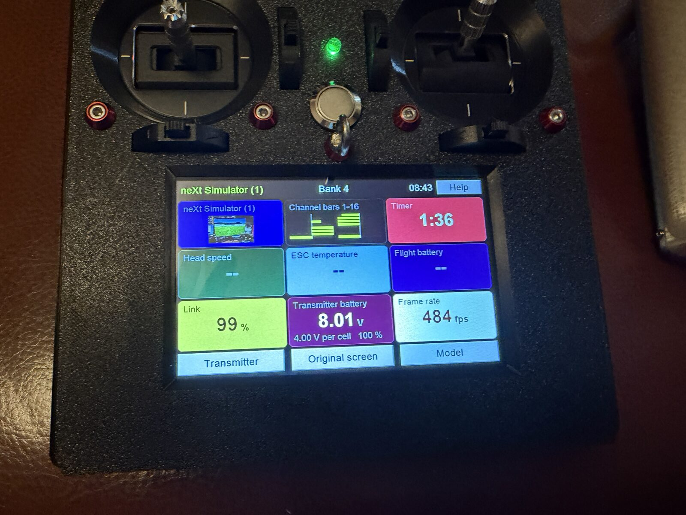
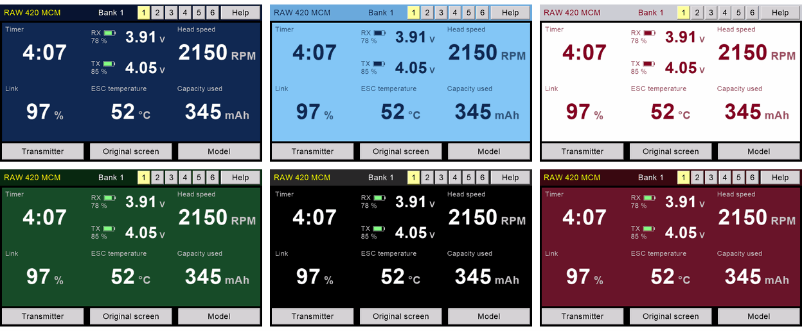
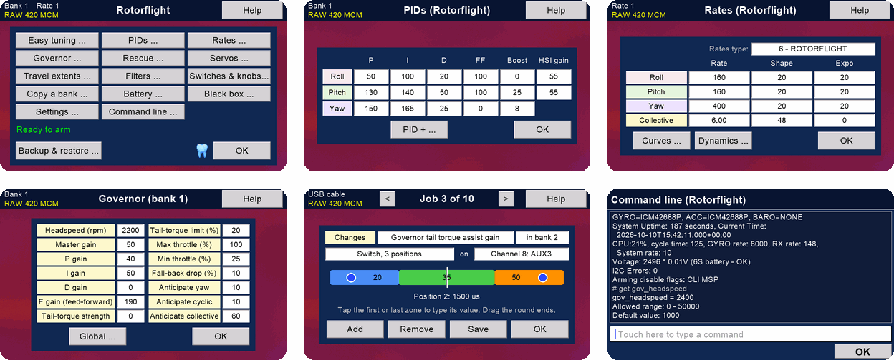
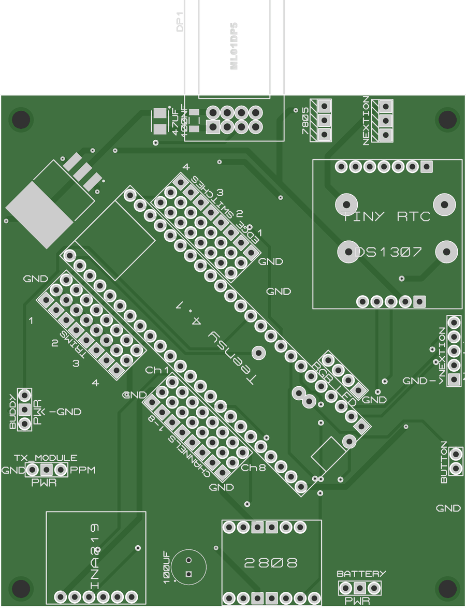
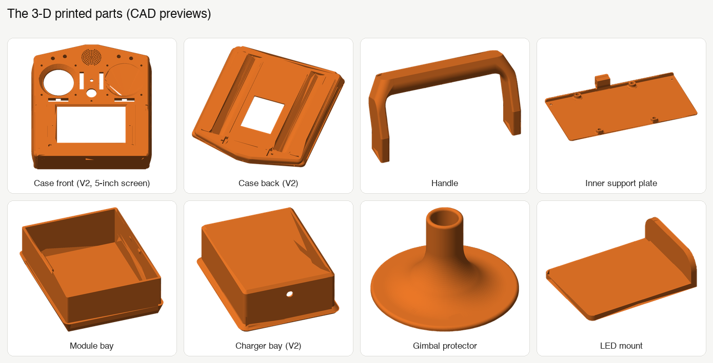

# The Version 2 transmitter



<sub>A Version 2 transmitter, showing a flight screen of its own design.</sub>

**A 16-channel 2.4 GHz transmitter that you build yourself.**

- **The main board flies the model.** A Teensy 4.1 reads the sticks, does the mixing and runs the radio link.
- **The screen talks to the pilot.** An Elecrow CrowPanel 5.0 (ESP32-S3, 5-inch touchscreen, WiFi, Bluetooth) draws the pages and fetches updates. Its firmware is in [../TXV2-Screen](../TXV2-Screen).
- **It is Version 1 with a new screen and a new case front.** The main board, radio, sticks and switches are Version 1's.
- **Have a Version 1?** Your models, main board, sticks and switches stay. Print the Version 2 case front from [STL files/V2](STL%20files/V2): it holds the new screen. Fit the screen, and update the firmware. Keep your Teensy's own card (copy it to a computer first). Do not make the example card.
  <!-- TODO Malcolm: does a Version 1 owner also need the Version 2 case back (TX_BACK12a_V2), or only the front? Until you say, these READMEs and the website say front only. If yes, say "front and back" in all three READMEs and on the website. -->
- **Building one?** Start with [Build one](https://messiter.com/ldrc/build.html) on the website. This README has the same steps, with the files.

---

## What it does



<sub>One flight screen in six of the twelve themes. Sample values.</sub>

**Flying**
- 16 channels. Any stick, switch or knob can drive any channel.
- 4 banks (flight modes), each with its own curves, trims and mixes.
- 5-point curves, 3 rates, 32 mixes, 8 timed macros, servo speed, subtrim, reverse, failsafe.
- **Eight switches, any job:** banks, motor, safety, rates, buddy, or the input of any channel 5–16.
- **Wireless buddy box** with no extra hardware, and a "nudge" mode for the instructor.

**Model memories**
- 90 model memories, and as many backups as the card holds.
  <!-- TODO Malcolm: 90 memories: the code (MAXMODELNUMBER 91: the Models page, automatic model selection and the buddy match run 1-90) and MODELS.TXT say 90. Only the Check IDs page (Model_IDs.h) scans 1-89: please check memory 90 shows there. -->
- **The right memory loads by itself** when you switch a model on. This is rare: elsewhere we found it only on Multiplex's SMART SX, with its ID receivers (some have a fixed ID, some can be set), and on Mikado's VBar Control, which keeps each model's settings in the model.
- **Send a model memory to another transmitter** over the radio link. A Version 1 transmitter can send its models to a Version 2 over the air (tested), and two Version 2s swap them.

**The screen**
- **Your own flight screens:** six designs on tabs, each with up to nine boxes of big numbers.
- **Twelve colour themes**, each one editable.
- **Model pictures** sent from your phone by scanning a QR code.
- **Help on every page**, spoken messages, log files, and Pong for rainy days.

**Rotorflight on the transmitter** (needs a Version 2 receiver)
- PIDs, rates, governor, rescue, servos, mixer, gyro filters, switches, copy a bank, battery, black box, calibrate.
- **Back up the Rotorflight tune and set-up**, every bank, to the card, and put it back exactly. Ports, LED, GPS and ESC settings are not included.
- **Edit with the model switched off.** The changes go across when it next connects.
- With the receiver's USB cable to the flight controller: setting up in-flight adjustments (they then work without the cable), Rotorflight's command line, and the whole set-up saved to the card as text (Rotorflight's `diff all`).
- The settings travel over Bluetooth from the screen to the receiver, never over the flying link, and only while the model is disarmed.

<!-- TODO Malcolm: compare.md says Battery, Black box and Calibrate (B88) were not yet tried on hardware on 10 Oct. Confirm before release notes call them proven. -->

**Link and diagnostics**
- Packets a second, lost packets, longest gap, swaps between the receiver's radios.
- A chart of reconnection times, and a scan of the 2.4 GHz band for interference.

**Updates and safety**
- **One button updates the whole transmitter** from the internet: screen, card, main board, help texts.
- **The receiver can be updated through the transmitter.**
- Nothing changes in flight. No transmitter update, file transfer or restart starts while a model is connected. A receiver update runs only with the safety on, and the receiver refuses while armed. WiFi and Bluetooth switch off whenever the model could fly.



<sub>Rotorflight set-up on the transmitter. Sample values.</sub>

---

## What is in this folder

| | |
|---|---|
| `TransmitterCode/` | The Teensy 4.1 firmware (PlatformIO). `include/` holds nearly all of it, one header per subject. `src/main.cpp` is set-up and the main loop |
| `TransmitterCode/SD Examples/Teensy SD Example/` | What goes on the Teensy's microSD card |
| `Help files for SD/` | The help texts (60): one for each page, and two kept for reference |
| `Noises/` | The sounds: voice messages, prompts and sound effects |
| `Circuits/` | The circuit boards as Proteus projects, with Gerbers in the `CADCAM` folders. `Transmitter - CADCAM` is the transmitter's main board. The `Receiver` and `SensorHub` folders are Version 1's receiver boards |
| `STL files/` | The printed case. `STL files/V2/` holds the Version 2 parts. The rest are the Version 1 parts that Version 2 shares. STEP sources in `STL files/STEP files/` |
| `Images/` | Photographs |
| `dev/` | Malcolm's tools: the release tool, the firmware packager, the publisher of this folder |
| `V1B-UPDATES.md` | The change log, newest first. Version 2 was called "V1B" while it was being made |

---

## Parts



<sub>The main board, drawn from the Gerbers in `Circuits/Transmitter - CADCAM`. The same board flies Version 1 and Version 2.</sub>

| Part | What to buy | Qty | Notes |
|---|---|---|---|
| Main board | Printed circuit board from the Gerbers in `Circuits/Transmitter - CADCAM` | 1 | 2 layers, about 83 × 91 mm. Any PCB maker |
| Microcontroller | PJRC **Teensy 4.1** | 1 | |
| Radio | Ebyte **E01-ML01DP5** (nRF24L01+ with amplifier) | 1 | In a 2 × 4 socket |
| Screen | Elecrow **CrowPanel 5.0" ESP32 HMI**, the **N4R8** version (4 MB flash, 8 MB PSRAM) | 1 | **Not** Elecrow's 16 MB 5-inch IPS panel: its pins differ and it shows a black screen |
| microSD card | For the Teensy. FAT32 or exFAT | 1 | |
| microSD card | For the screen. **FAT32** (cards over 32 GB come as exFAT: reformat them) | 1 | The screen fills it itself |
| Power switch | **Pololu 2808** pushbutton power switch | 1 | |
| Push button | 16 mm vandal-resistant, momentary | 1 | The on/off button |
| 5 V regulators | Pololu 5 V 1 A **S13V10F5**, or a 7805 | 2 | One for the Teensy, one for the screen |
| 3.3 V regulator | **AMS1117-3.3** | 1 | |
| Battery sensor | **INA219** current/voltage sensor module (I²C) | 1 | Reads the transmitter's battery. Without it there is no battery reading |
| Clock | "Tiny RTC" **DS1307** module with a coin cell | 1 | Use its **left** 5-pin header. It needs **5 V** to answer. The screen sets it from the internet |
| Sticks | **FrSky M9** Hall-sensor gimbals | 2 | |
| Trims | **FrSky trim switches**, X9D Plus spare part | 4 | |
| Top switches | Three-position RC switches | 4 | |
| Front controls | Three-position switches or knobs (potentiometers) | 4 | Any mix |
| Status light | 5 mm RGB LED | 1 | The board and the firmware suit a common-cathode LED |
| Speaker | 8 Ω (or 4 Ω), 1–2 W | 1 | On the screen's SPK socket (JST PH 2.0, 2-pin) |
| Battery | 2S: LiPo, Li-ion or LiFePO4 | 1 | Always two cells |
| Charger | 2S balance charger: a micro-USB module, or a USB-C 2S module | 1 | Must match the battery type: LiPo/Li-ion or LiFePO4 |
| Diodes | 1N5406 ×2, 1N4001 ×2 | 4 | |
| Capacitors | Electrolytic 330 µF ×1, 100 µF ×1. Tantalum 330 µF (0E907) ×2, 47 µF 1206 ×2. Ceramic 1206: 330 nF ×2, 100 nF ×4, 10 µF ×1 | 13 | |
| Aerial | RP-SMA 2.4 GHz aerial and a 20 cm RP-SMA extension | 1 | |
| Screen leads | A USB-C lead to cut up (5 V into the screen). An HY2.0 4-pin lead (the screen's serial port) | 1 each | |
| Connectors | Male and female headers, 3-row headers, a 2 × 4 socket, servo cable, DuPont 3- and 4-pin | Various | |
| Case | Printed in PETG (or what you prefer) | 1 set | See below |
| Fixings | Self-tapping screws (3 mm, 2 mm flange), M3 bolts and lock-nuts, 2 mm cable ties, 5-minute epoxy | Various | |

**Cost:** over £120 in parts (approximate, October 2026; the full total is coming). See [Build one](https://messiter.com/ldrc/build.html) for current figures.

<!-- TODO Malcolm: (1) The old README said "common anode" for the RGB LED; the board's netlist and the firmware (analogWrite HIGH = on) suit common cathode. Which do you fit? (2) 5 V regulators: S13V10F5, S7V7F5 or 7805? Which one for the screen rail? The screen's current draw has never been measured. (3) INA219: confirm the exact module. (4) Exact USB-C 2S charger module (the "2326" board) and its wiring. (5) ML01DP5 aerial connector gender (SMA or RP-SMA). (6) Recommended battery pack and speaker part. (7) The exact three-position switch part, and whether any are two-position. (8) Re-cost the V2 parts. -->

### The case



<sub>The printed parts. Previews drawn from the CAD files.</sub>

- **Version 2 parts** in [`STL files/V2`](STL%20files/V2): the case front cut for the 5-inch screen, the case back, and the charger bay. The front and back are STEP files; most slicers open them directly.
- **Shared with Version 1** in `STL files/`: `TX_HANDLE`, `TX_SUPPORT`, `GimbalP` (gimbal protector), `LEDMOUNT`, `MODBAY` and `Blank`, `SPACER`.
- `TX_FRONT.stl` and `TX_BACK12.stl` are **Version 1's** (cut for the old Nextion screen). Do not print them for a Version 2.
- The CrowPanel has no mounting holes. The case front holds it.

<!-- TODO Malcolm: STL files/V2 (TXV12a_Front_V2.step, TX_BACK12a_V2.step, CHARGERBAY.stl) is committed in TXV1B (d774bb9) and reaches LDRC_V2 at the next publish_public.py run; until then this link is a 404. Add print settings and how the CrowPanel is held. Is MODBAY + Blank still printed on a V2, or does the charger bay replace it? -->

---

## Build it

> [!WARNING]
> **Radio rules.** The radio modules that transmit and receive, Ebyte's E01-ML01DP5 (transmitter) and E01-ML01SP4 (receiver), carry the CE mark and FCC ID 2ALPH-E01. They run at about 100 mW (20 dBm), the UK and EU limit for 2.4 GHz; an aerial cannot add power, it only shapes where the signal goes. As with any model you build yourself, check the radio rules where you live before you fly.

Work in this order. Each step ends with a check.

1. **Order the main board.** Send the Gerbers in `Circuits/Transmitter - CADCAM` to any PCB maker.\
   *Check:* the board matches the picture above.
2. **Print the case.**\
   *Check:* the screen, sticks and switches fit their holes before you wire anything.
3. **Flash the screen first, by USB, before it is wired in.** Its serial port is shared with its USB chip, so do it while the USB socket is free. Follow [../TXV2-Screen/README.md](../TXV2-Screen/README.md).\
   *Check:* the screen joins your WiFi, fills its card and restarts as a complete screen.
4. **Flash the Teensy on its own, by micro-USB, before it goes on the board.** See [Flash it, once](#flash-it-once), step 1.\
   *Check:* PlatformIO ends with `SUCCESS`.
5. **Solder the small parts:** the 1206 capacitors, then the diodes, regulators, sockets and headers. Then fit the Pololu 2808 power switch, wire the push button, and fit the battery lead (BATTERY header).\
   *Check:* battery off: the resistance across the battery plug is not near zero. With the meter on volts across the battery's own plug, the pin that meets the board's + reads plus 6 to 8.4 V. Then connect the battery, switch on, and measure 5 V on the Teensy socket's VIN, 5 V on the screen header's middle pin and 3.3 V on the radio socket's VCC.
6. **Fit the modules:** the flashed Teensy 4.1, the ML01DP5 radio, the INA219, the clock (left header, 5 V). Screw the aerial and its extension onto the radio now: it transmits at full power from switch-on, and with no aerial its amplifier can be damaged.
7. **Wire the controls** (pins in the table below):
   - **Sticks: wire them as for Mode 1**, whatever mode you fly. The firmware swaps them for Mode 2.
   - Trims, the four top switches, the four front controls and the RGB LED.
   - A knob (potentiometer) has its ends on 3.3 V and ground and its wiper on the pin.
8. **Wire the screen** to the old Nextion header:
   - Teensy **pin 1 (TX1)** → screen port **J10 pin 1** (IO44, the screen's RX).
   - Teensy **pin 0 (RX1)** ← screen port **J10 pin 2** (IO43, the screen's TX).
   - **Ground** to J10 pin 4. **Leave J10 pin 3 unconnected**: it is a 3.3 V *output*.
   - **5 V** from the board's screen rail (the Nextion header's pin 3) through a cut USB-C lead into the screen's USB-C socket. The screen takes power only through USB-C.
   - The **speaker** on the screen's SPK socket.
   - Pin 1 of the board's screen header is GND. Find it with a meter on beep, battery off: it beeps to the battery's −.
   - **Never two power supplies:** do not plug a computer into the screen's USB-C socket while it is wired to the board.
   - *Check:* both sides are 3.3 V logic. TX goes to RX, RX to TX.
9. **Make the Teensy's card** ([Flash it, once](#flash-it-once), step 2).
10. **Switch on.** First check the resistance across the battery plug again (not near zero). Then do the first start (below).

<!-- TODO Malcolm: (0) Confirm the bench check in step 5: can the board be powered for a rail check with only the 2808 and button fitted? (1) Front three-position switches on the analogue pins A6-A9: what resistor values? (2) Top switches: confirm ON-OFF-ON with the centre tag to ground. (3) Do the 2023 Gerbers ("Transmitter2_v5") match the board you build today? (4) Any obsolete parts on the board? (5) Photos of the inside for this section. -->

### Teensy pins

| Teensy pin | Goes to |
|---|---|
| 0, 1 (Serial1) | The screen (921,600 baud) |
| 2, 3, 4 | RGB LED: red, green, blue |
| 5 | Power off (Pololu 2808) |
| 7, 8 + SPI | Radio: CE, CSN |
| 18, 19 (I²C) | INA219 (0x40) and the clock (0x68) |
| 25–32 | The four top switches, two pins each |
| 33 | The power button (sensed) |
| 34–41 | The four trims, two pins each |
| A0–A3 | The sticks (channels 1–4) |
| A6–A9 | The four front controls (channels 5–8) |

---

## Flash it, once

After this, the transmitter updates itself.

**You need** [PlatformIO](https://platformio.org/) (the VS Code extension, or the `pio` command).

> [!WARNING]
> **Flash the Teensy before it goes on the main board.** Do not plug USB into a Teensy fitted to the board unless its VUSB–VIN pad is cut.

<!-- TODO Malcolm: confirm the VUSB/VIN advice. The Teensy 4.1 joins USB 5 V to VIN unless that pad is cut (PJRC's advice); with the board's 5 V rails on VIN, USB could back-feed the rails and the screen. Is the pad cut on your boards, or do you never plug USB into a fitted Teensy? Until you say, this README and the website flash the Teensy off the board. A Version 1 owner's Teensy is already fitted: should they lift it out of its socket for the first Version 2 flash? -->

1. **Flash the Teensy on its own**, plugged into your computer with a micro-USB data cable:

   ```
   cd TXV2/TransmitterCode
   pio run -e teensy41 -t upload
   ```

   PlatformIO fetches the libraries and runs the Teensy loader. If it sits waiting, press the small white button on the Teensy.
2. **Make the Teensy's card.** Copy everything in `TransmitterCode/SD Examples/Teensy SD Example/` to its microSD card: `help/`, `Images/`, `mod/` and `MODELS.DAT`. Add an empty folder called `log`.
   - The example `MODELS.DAT` holds Malcolm's models. Start with them, or reset (below) and make your own.
   - (Version 1 owner: skip this. Keep your own card.)
3. **Flash the screen** as [../TXV2-Screen/README.md](../TXV2-Screen/README.md) says, if you have not already.

---

## First start

1. **Reset the transmitter** (a new transmitter only): *Transmitter setup → Calibrate → Reset transmitter.* It takes a few minutes. It deletes the model memories (not their backup files) and sets Mode 2.
2. **Set the stick mode** (1 or 2), and **switch Automatic model selection on**: *Transmitter setup → System → General.* Reset transmitter switches it off. Press **OK** to save (Next does not save the page).
3. **Calibrate:** *Transmitter setup → Calibrate.* Press **Calibrate sticks etc.**, move every stick and knob to its ends a few times, press **Next**, centre everything, push the four top switches away from you, press **Finish**. Redo this after changing sticks or mode.
4. **Calibrate the trims**, so each one works the right way.
5. **Set the battery type** (LiPo, Li-ion or LiFePO4), so the percentage is right.
6. **Join WiFi:** *Transmitter setup → WiFi.* Type the password on the screen. A phone hotspot works at the field. On an iPhone, switch on **Maximise Compatibility** (the screen uses 2.4 GHz only).
7. **Give the switches their jobs:** *Transmitter setup → Switches.*
8. **Bind a receiver:**
   - **Blades or propeller off, safety on**, before the model is switched on.
   - Put the receiver in bind mode. A new receiver is in bind mode already: its light flashes twice a second.
   - Hold the transmitter's power button for 2–5 seconds while switching on. It chirps and says "binding enabled". (Or *Transmitter setup → System → General → Bind.*)
   - Choose an empty model memory first. When the transmitter asks to save the receiver's ID, press OK (Cancel saves nothing, and the model does not connect). Check it on *Model setup → Model IDs*. From then on the transmitter loads it by itself.
   - Every receiver bound to this transmitter obeys it: **switch on one model at a time.**

---

## Test before you fly

Blades off for every test. Unplug the motor too, unless the test needs it. The full list is on [Build one](https://messiter.com/ldrc/build.html).

- **Link:** *Model setup → Telemetry.* About 500 packets a second. The longest gap should be well under 100 ms; above about 250 ms, move the receiver's aerials.
- **Interference:** *Transmitter setup → Scan RF* shows the busy parts of the 2.4 GHz band.
- **Directions:** every control moves the right way. Fix it on the Reverse page.
- **Safety switch:** the motor cannot start with the safety on. WiFi and Bluetooth go off when the safety is off.
- **Failsafe:** set it first (SBUS/IBUS/PPM: *Model setup → Failsafe*; CRSF with Rotorflight: Rotorflight's own failsafe is in charge, so check it once in the Rotorflight Configurator's Failsafe tab, on a computer; neither the app nor the transmitter can change Rotorflight's failsafe). Blades off, model held down, safety off, run the motor slowly, then switch the transmitter off. The motor must stop within a few seconds and must not restart when the transmitter comes back.
- **Range:** there is no low-power test mode; the radio always runs at full power. Walk away from the model with the safety on and watch the packet rate.

<!-- TODO Malcolm: write the range test and failsafe test in your own words (distance, what to watch). -->

---

## Updates

**Transmitter setup → Transmitter updates.**

- The screen fetches the latest release from messiter.com over WiFi.
- It shows what is new. Nothing is installed until you press **Install now**.
- It updates what differs: the screen's firmware, the screen's card, the Teensy's firmware and the help texts.
- **Your files come first.** Before the Teensy is updated, your models, settings and logs are copied to the screen's card and read back. No copy, no update.
- **New Teensy firmware runs on trial.** If it does not start properly, the old one comes back by itself.
- **It checks your models.** If the new firmware would read any model's controls differently, it is refused and the old firmware is put back.
- **Earlier versions** puts back an older release just as easily.
- No update runs while a model is connected or the safety is off.

**The receiver too:** *Model setup → Receiver updates*, with the model switched on and connected, with the safety on (with no safety switch: the motor off). Version 2 receivers only.

Current versions and what changed: [Help & updates](https://messiter.com/ldrc/help.html).

---

## How the two boards talk

- The Teensy sends Nextion display commands at 921,600 baud: `page`, `vis`, `X.txt=`, `X.val=`, `get` and the rest.
- The screen draws the pages from their definitions on its card, and answers with exactly the bytes a Nextion would.
- So the Teensy's code did not need to know the display had changed. It now drives 76 pages: Version 1's 58, and 18 new Rotorflight pages.
- The screen's own features (updates, WiFi, themes, flight screens, pictures, the Bluetooth link to the receiver, Pong) are a few extra words on the same wire. They are listed in [../TXV2-Screen/README.md](../TXV2-Screen/README.md).

## Change log

[V1B-UPDATES.md](V1B-UPDATES.md), newest first. The Teensy's build is named `B<n>` and the screen's `<major>.<minor>.<patch>`. A release names both.

## Licence

- The Teensy firmware is **GPL-2.0-or-later** ([LICENSE](LICENSE)), like Version 1. It links the RF24 radio driver, which is GPL-2.0 only.
- Boards: CERN-OHL-S-2.0. Help texts, sounds, case files and pictures: CC BY-SA 4.0.
- The screen's firmware is GPL-3.0-or-later.

Details in [../LICENSING.md](../LICENSING.md). Copyright (C) 2020–2026 Malcolm Messiter. Made with Claude (Anthropic's AI) as pair programmer.
