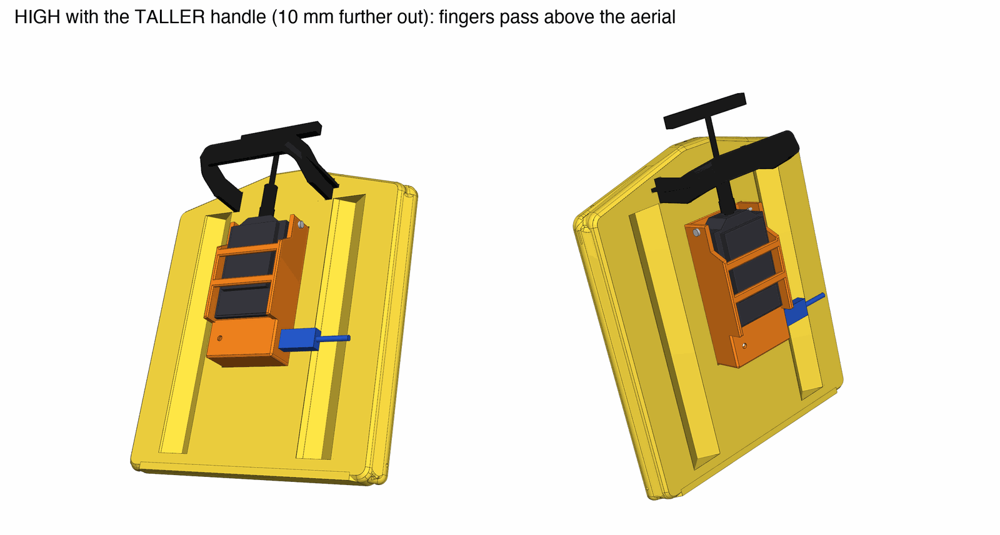
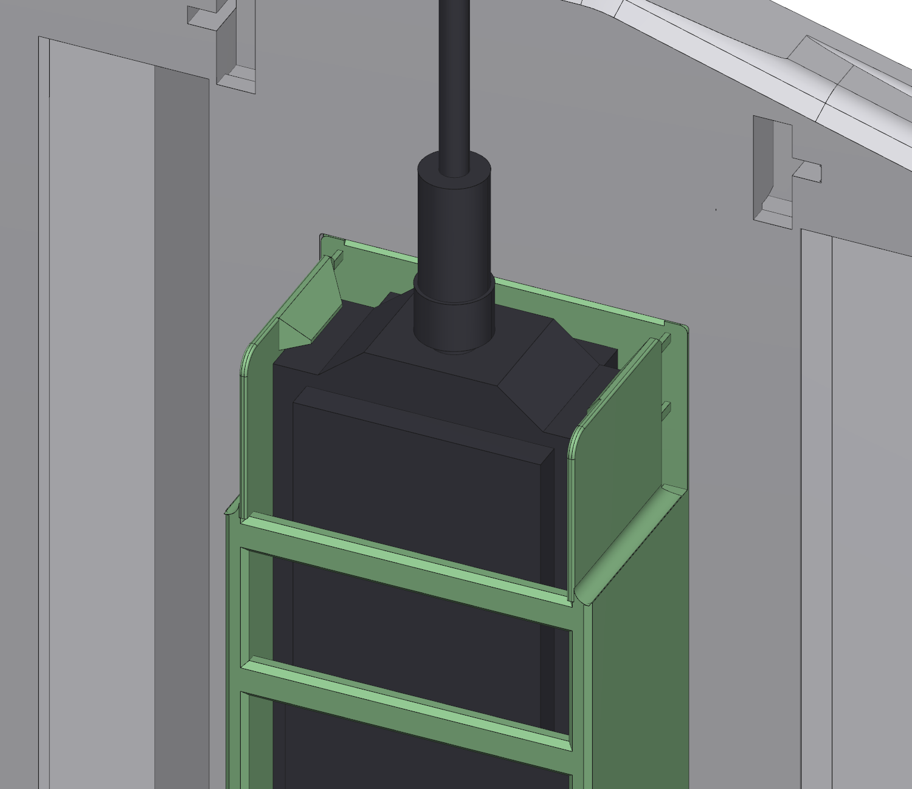
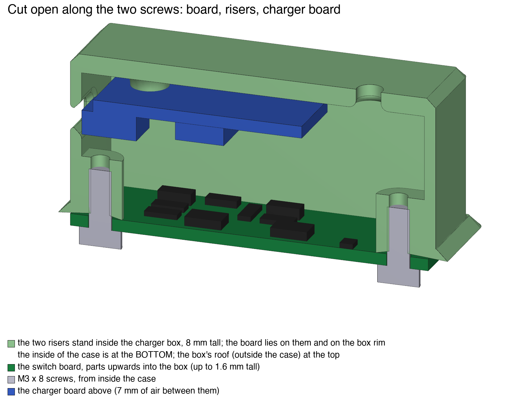
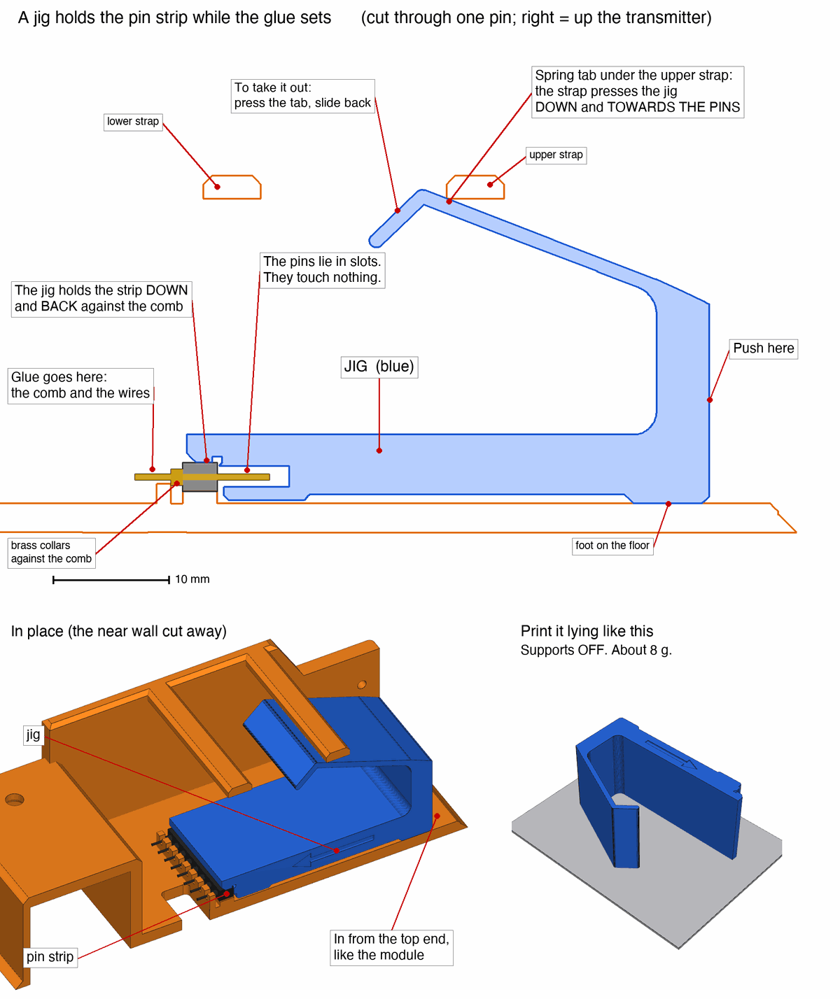

# Printed parts for an ELRS module

For a transmitter that carries an ExpressLRS (ELRS) module inside its case. These parts are made for Malcolm's module, a **RadioMaster Ranger Nano**. ELRS is being tested now: it is not in the released firmware yet.

First make the small change to the main board: [Optional: ready for an ELRS module](https://messiter.com/ldrc/build.html#tx-elrs).

There is one set of parts: the module sits high in the back, and it clicks into its bay. Each part is here twice: a STEP file for editing and an STL file lying as it prints.

The new back with the module and charger bay and the taller handle. Drawn from the design files. This picture shows the first bay, which held the module with two screws: the bay here holds it with two click arms, and everything else is where the picture shows it.

| File | What it is |
|---|---|
| `BACK_ELRS_HIGH.step` / `.stl` | **The case back.** Print it instead of `TXV12a_BACK_V2.step`: only its opening differs, longer and higher. The module's aerial goes up through the handle, and its tip stands above the top of the transmitter. |
| `ELRS_CHARGER_BAY_CLICK_SWITCHBOARD.step` | **The module and charger bay**, for editing. The module clicks in. Inside the case it has a place for the small board that switches the module's power. |
| `ELRS_CHARGER_BAY_CLICK_SWITCHBOARD_PRINT.stl` | The same bay lying as it prints: flange down, supports off. |
| `TX_HANDLE_TALL.step` / `.stl` | **A taller handle:** its legs are 10 mm longer, so your fingers pass above the aerial. It fits the same two pockets in the back. Turn it for printing as you would the standard handle. |
| `PIN_STRIP_JIG.step` | **The jig** that holds the pin strip while its glue sets, for editing. |
| `PIN_STRIP_JIG_PRINT.stl` | The jig lying as it prints: on its side, supports off. About 8 g. |
| `ELRS_MODULE_DUMMY.step` | **A dummy module**, for editing. It fills the bay and covers the pins when the module is out. |
| `ELRS_MODULE_DUMMY_PRINT.stl` | The dummy lying as it prints: on its face, supports off. About 25 g. |
| `ELRS_MODULE_CASE.step` / `ELRS_MODULE_CASE_LID.step` | **A storage box and its lid** for the module with its aerial on, for editing. |
| `ELRS_MODULE_CASE_PRINT.stl` / `ELRS_MODULE_CASE_LID_PRINT.stl` | The box and the lid lying as they print, supports off. |

**What is proven so far:** the bay with its two click arms is printed and in use. The place for the switch board, the dummy and the storage box are new: they are checked by computer, and their first prints will be reported here.

Print the bay in PETG: its two arms bend every time the module goes in or out. The other parts print in PETG or PLA, like the rest of the case. Most slicers open STEP files directly.

## The module and charger bay

- It is one part, glued into the back from the inside with five-minute epoxy, like the Version 2 charger bay.
- At the bottom, the USB-C charger board sits on the same two risers as in `CHARGERBAY.stl`. Its lead plugs in from the right (seen from behind), so the transmitter still stands up while it charges. The red charge light goes in the hole in the face.
- Above it is a pocket for the module. The module slides in from the top, under two straps, onto a strip of pins. A strip of felt or foam tape under each strap stops any rattle.
- **The pins:** an 8-way 2.54 mm **turned-pin** strip (round pins, about 0.5 mm: the module's sockets do not take square DuPont pins). It lies in a little comb, its fat brass collars against the comb and its long thin pins pointing up, towards the module. The wires go through the window behind it.
- Only three pins are wired. The module's sockets 1, 2 and 3 are SIGNAL, GROUND and BATTERY: from the left, looking at the module's back with its aerial up. Check yours before you glue. The module's own XT30 power socket then stays empty.

### The click

The two arms and their teeth, holding the module by its shoulders.

- Above the upper strap, each side wall is a springy arm with a tooth.
- **In:** slide the module down. Near the end the two teeth ride over its sides, then snap over its two shoulders. It only clicks when the module is fully home: no click, not home.
- **Out:** spread the tops of the two arms a few millimetres with thumb and finger, and slide the module up.
- The undersides of the teeth are flat, so pulling on the module does not open them. Spread the arms only as far as the module needs.

### After printing

- A loose prop holds up the charger's two risers while they print. Snap it out.
- Under each arm are two tiny posts that hold it up while it prints. **Snip all four off** with flush cutters before you use the bay, and do not force the arms while the posts are on.

### The place for the power switch board

The charger box cut open: the switch board on its two risers, the charger board above it.

The module must be off when you fly LDRC. A small board can switch its power, so that the transmitter itself turns the module on only for a model that uses it. The board and the firmware for it are being tested: its design files will follow here. See the build guide's [Power for the module](https://messiter.com/ldrc/build.html#tx-elrs). Until then the simplest and safest way is no switch at all: the module in only when you fly ELRS, out for LDRC, and in or out only with the transmitter off.

- The board goes inside the case, across the open side of the charger box. Its parts face into the box, where they are protected.
- It lies on two risers in the box and is held by two M3 x 8 screws, pan head or button head, put in from inside the case. They cut their own thread in the 2.5 mm holes. If a screw is too tight, drill the hole out to 2.6 or 2.7 mm.
- The charger's own two wires come out through a small tunnel at the module end of the box, under the board's edge.
- Fit the charger board first. Solder the switch board's wires before you screw it on. To reach the charger board later, undo the two screws.
- Check that there is about 8 mm of room inside your case under the charger box, for the board, the screw heads and the wires.

## The jig

Holding the pin strip still while its glue sets is very hard by hand. The jig holds it for you. Malcolm's way, from experience:

1. Put the strip in the comb, its fat brass collars against the comb and its long thin pins pointing up. The wires go through the window.
2. Put sticky tape over the window at the back, so that glue cannot run through it.
3. Rub a little candle wax or grease on the jig's nose, so that the glue cannot hold it.
4. Slide the jig in from the top end, like the module, until it stops. The pins lie in its slots and touch nothing.
5. Very carefully, put one drop of thin superglue where the strip meets the comb. It runs: keep it well away from the pins.
6. When the superglue has set, press the tab and slide the jig out.
7. Then reinforce the joint with a generous amount of five-minute epoxy, over the comb and the wires. Be extremely careful not to get any on the pins or their connections.

A spring tab goes under the upper strap. The strap presses on its slope, and that holds the strip down on its pad and back against the comb. Never glue the strip with the module in place: glue must not reach the module.

The jig: how it holds the strip, in place in the bay, and how it prints.

## The dummy module and the storage box

- **The dummy** goes in exactly like the module and clicks in the same way: it has the same two shoulders. Its lower part stands clear of the pin strip, so it covers the pins without touching them. Use it whenever the module is out: no dirt on the pins, and nothing metal can reach them.
- To take it out, spread the two arms and push it up with your thumb in the slot near its top.
- **The box** holds the module with its aerial on: turn the T of the aerial flat, across the box. The aerial never needs to come off, so its thread does not wear. Two ribs hold the module still, and the lid slides in from the open end and clicks shut.
- The box takes a module and aerial up to 138 mm long, measured from the module's bottom edge to the far edge of the T. Malcolm's is 135 mm.
- When the module is in the transmitter, keep the dummy in the box.

Check the repository before printing: a newer version may follow.

How to build the whole transmitter: https://messiter.com/ldrc/build.html
